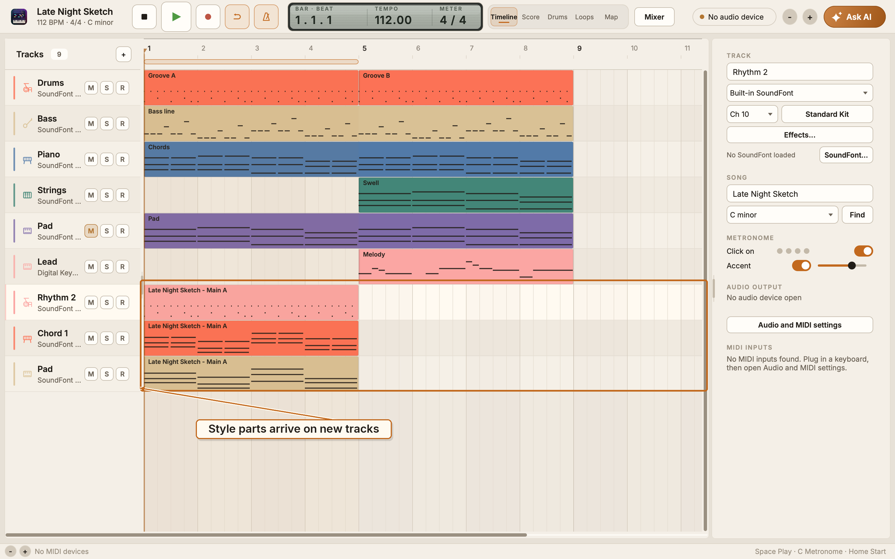
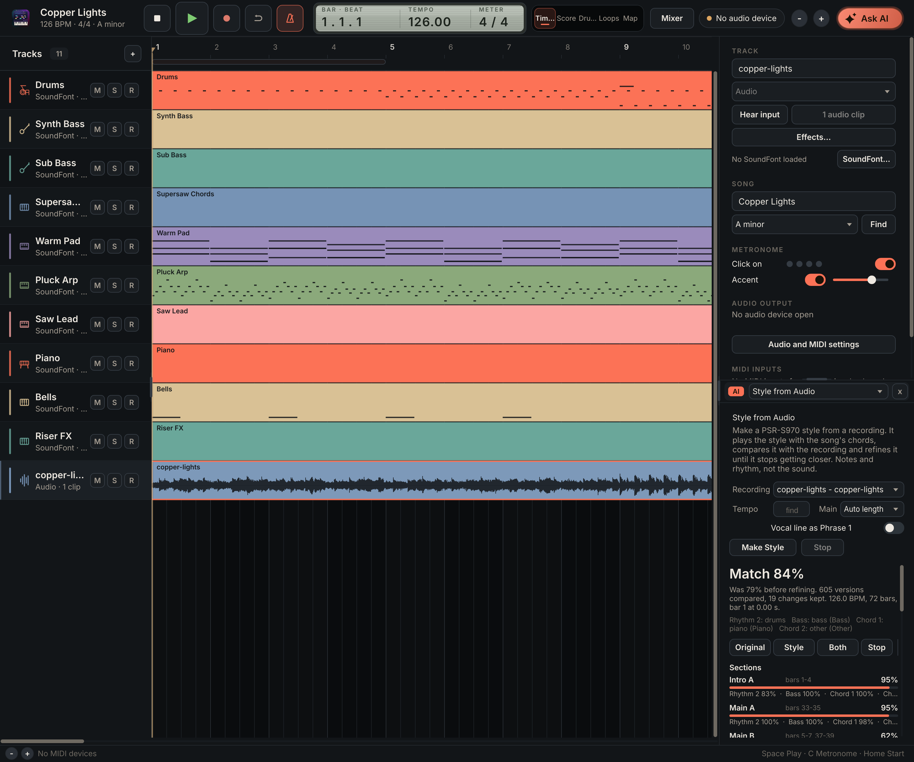
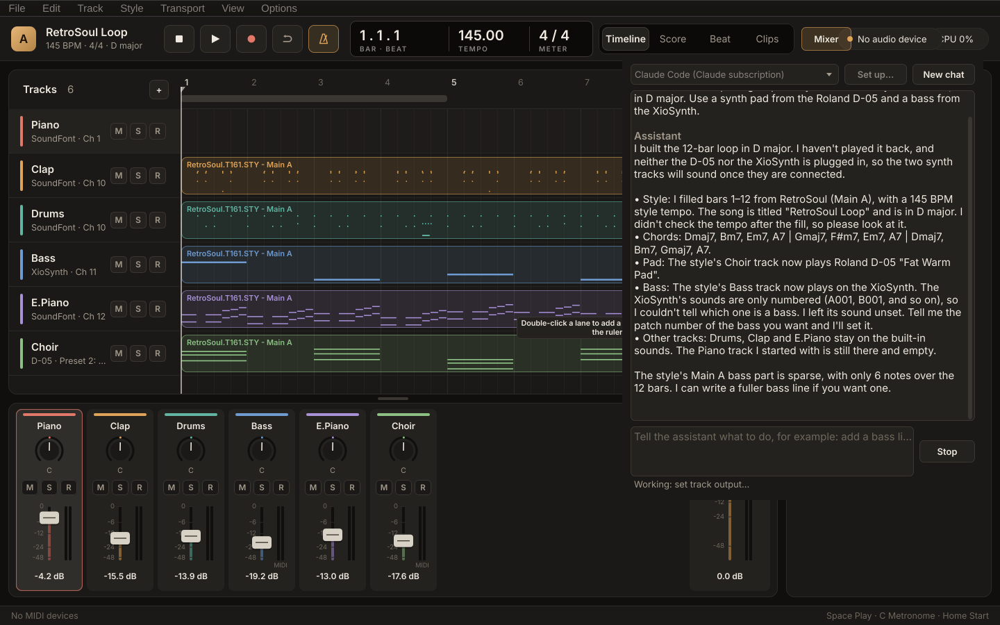
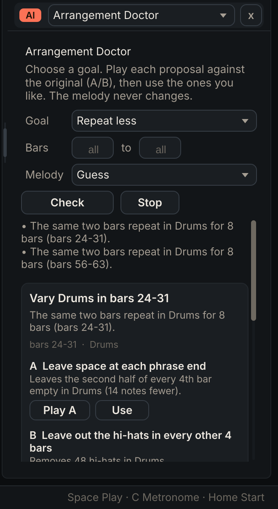
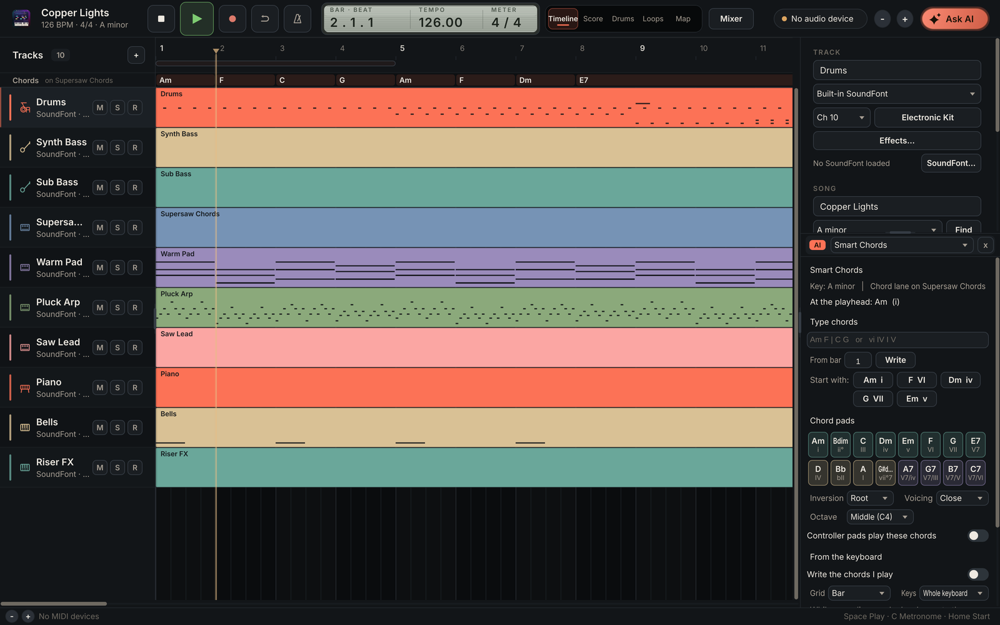
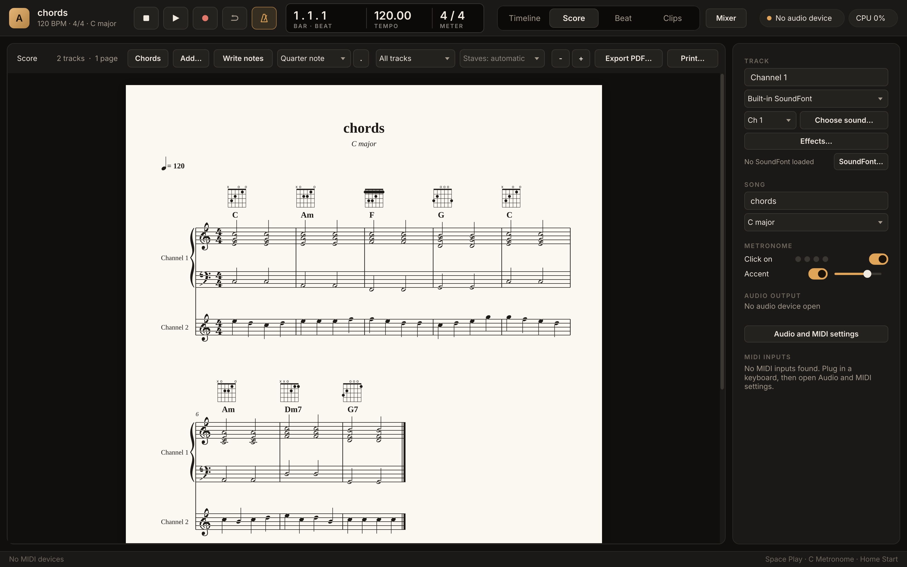
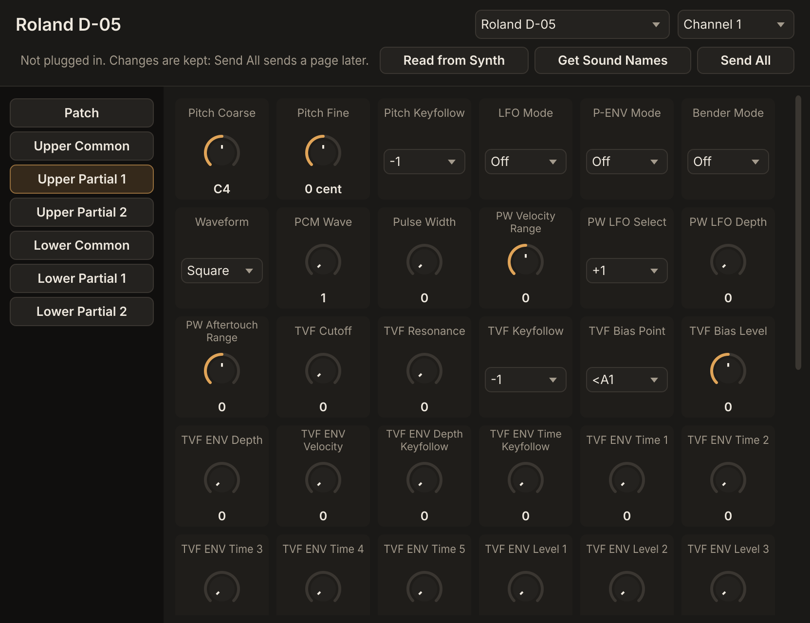
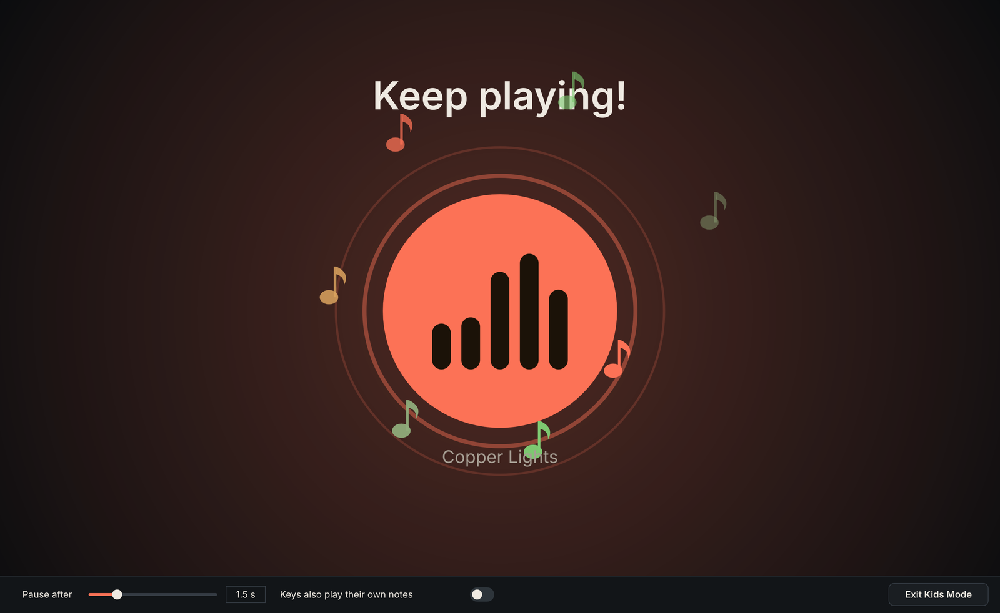

# Lazy Arranger Midi DAW

A desktop studio for people who arrange songs. Write with styles and chords,
let the AI help with the arrangement, print the score, and play it all on your
own keyboards and synths. Light and fast, for macOS, Windows and Linux.

[Download the latest public release](https://github.com/nhth-mibu/lazy-arranger-midi-daw-releases/releases/latest).

## Arranger keyboard styles, on the computer

Open Yamaha `.sty` and `.prs` styles, and Korg styles in the SFF format. Play
the sections with chords, or fill tracks from a style: the parts follow the
chords of your song. Edit the parts and their chord rules, then save a new
style. Make a style from your own clips or from a MIDI file.

When the song is ready, export it for the Yamaha PSR-S970. Each track gets the
nearest keyboard voice, with tempo and lyrics. Copy it to a USB stick and play
it on the keyboard without the computer.



## A style from any recording

Give the app a recording, or a link to a song online. It splits the song into
stems, finds the notes, chords and lyrics, and makes a style that you can play
on the keyboard. When a chord or bass note is not clear, the app asks you:
listen to A and B, and pick one.



## An AI that works inside your song

Open the chat and ask in plain words: "add a bass line that follows the
chords", "make the drums quieter in the chorus". The assistant changes the
song for you, and each change is one undo step. Use your Claude, ChatGPT or
Gemini subscription, or an API key. Speak to it and let it read the answers
aloud.

The app is also an MCP server, so Claude Desktop, Claude Code and other MCP
clients can open and change your project from outside the app.



## Arranging help

- **Arrangement Doctor** finds a chorus that does not lift, parts that crowd
  the melody, busy bars and parts that repeat too much. It proposes fixes.
- **Fit to My Synths** checks the song against each of your hardware synths:
  how many notes they can play at once, their parts, note ranges and drum kits.
- **Groove** takes the feel of a drummer, a file or a few words ("lazy swing,
  behind the beat") and puts it on stiff parts.
- **Song Forms** makes a short version, a long intro, a gig version or a solo
  break, with fills and lead-ins where sections meet.

Each tool lets you play A and B before you choose. Nothing changes until you
say so.



## Smart chords

Type `Am F C G` or `vi IV I V` into the chord lane. The app suggests the next
chord, gives you 16 chord pads for the song key (also on the Launchkey pads),
writes down the chords you play on the keyboard, and reharmonizes a bar with
the bass and chord parts moved to match.



## A real score

Every song is also printed music. Full scores, grand staves and drum staves,
with chord symbols, guitar chords, lyrics and dynamics. Enter notes with the
mouse, the computer keyboard or a MIDI keyboard. Print, or export PDF and
MusicXML.



## Made for your keyboards and synths

- Plug in a keyboard or controller and play. The app turns its input on.
- Device profiles tell the app the sounds and messages of each synth. Ready
  for the Yamaha PSR-S970, Roland D-05, Novation XioSynth, Korg Pa, GS and XG.
  The AI can write a profile for a new synth from its MIDI chart.
- Sound editors with knobs for the Roland D-05 and Novation XioSynth.
- Mixer pages for the Launchkey Mini MK3, X-Touch Mini and XioSynth. MIDI
  Learn for any other controller.
- Import a multitrack recording from the Zoom LiveTrak L6max.



## Kids Mode

A child presses any key and the song plays, as if the child plays it. Stop
pressing, and the song waits.



## And a full DAW

MIDI and audio tracks, piano roll, step drum patterns, a loop slicer, a clip
grid for live scenes, a mixer with buses and sends, automation, and VST3 and
Audio Unit plugins. The app is native and small. When nothing plays, it uses
almost no CPU.

## Download

Open [Releases](https://github.com/nhth-mibu/lazy-arranger-midi-daw-releases/releases)
and choose the latest release. Each release includes:

- **macOS:** `ArrangerMidiDaw-macos-universal.dmg` (arm64 and x86_64).
- **Windows:** `ArrangerMidiDaw-windows-x64.zip`.
- **Linux:** `ArrangerMidiDaw-linux-x64-ubuntu-26.04.tar.gz`.
- The Arranger Demo Styles ZIP when a release includes it.
- A `.sha256` file for each package.

Check a package before opening it:

```sh
shasum -a 256 -c ArrangerMidiDaw-macos-universal.dmg.sha256
```

The macOS app is ad-hoc signed, not Developer ID signed or notarized. Windows
needs the Microsoft Visual C++ v14 x64 Redistributable. The Linux package targets
Ubuntu 26.04 x64. The packages do not include a General MIDI SoundFont.

The application source code is private. This public repository holds the
documentation and the binaries only. GitHub's "Source code" archives for its
tags contain only these public files, not the application source.

## Learn more

- Feature sheet: a two-page overview, as [PDF](docs/Arranger-MIDI-DAW-Feature-Sheet.pdf) or [Word](docs/Arranger-MIDI-DAW-Feature-Sheet.docx)
- [User manual](docs/user-manual.md): how to use the app, in simple English
- [Device profiles](docs/device-profiles.md): teach the app a new synth with one YAML file
- [Controller mixer pages](docs/controllers.md): what each knob and button does
- [All releases](https://github.com/nhth-mibu/lazy-arranger-midi-daw-releases/releases) and their release notes

Tested with the Yamaha PSR-S970, Roland D-05, Novation Launchkey Mini MK3,
Novation XioSynth 49, Behringer X-Touch Mini and Zoom LiveTrak L6max. Other
models were not tested.
