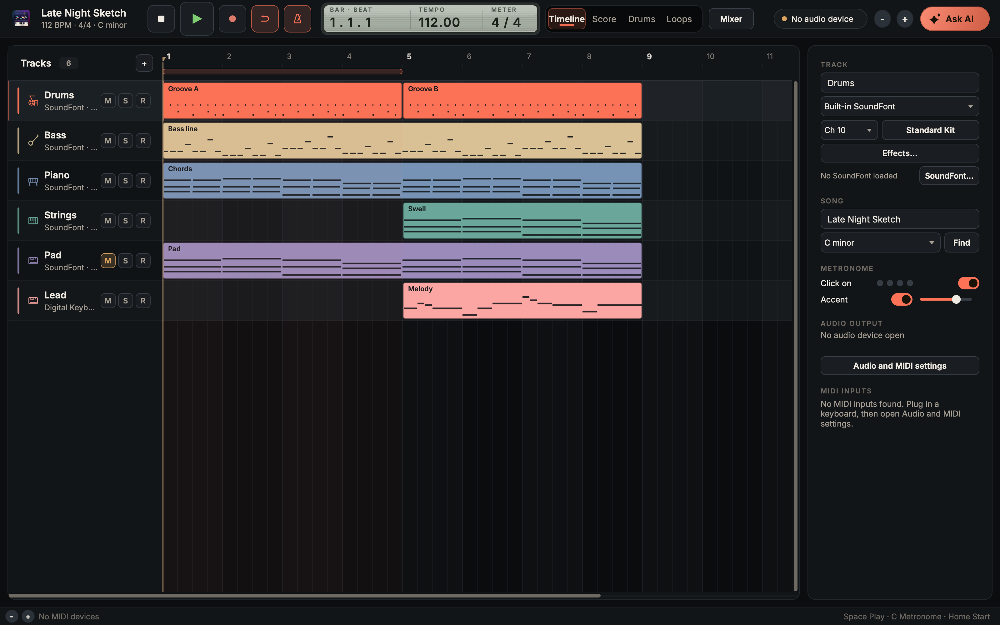
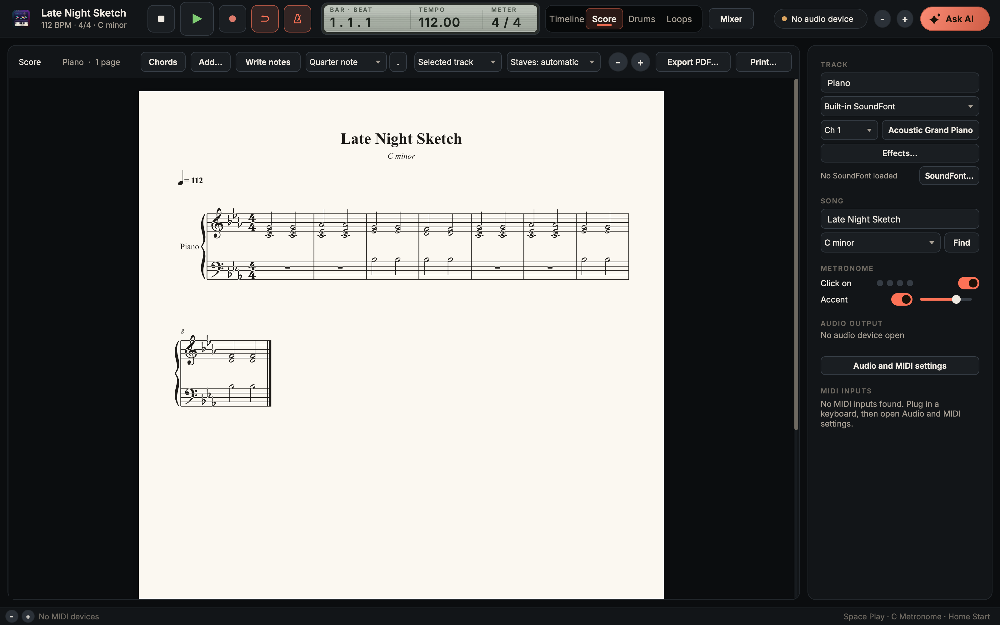
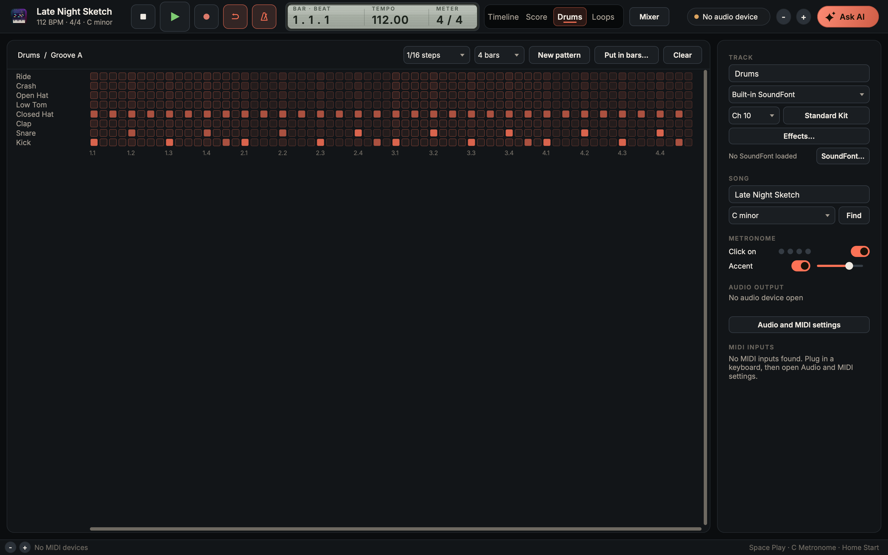
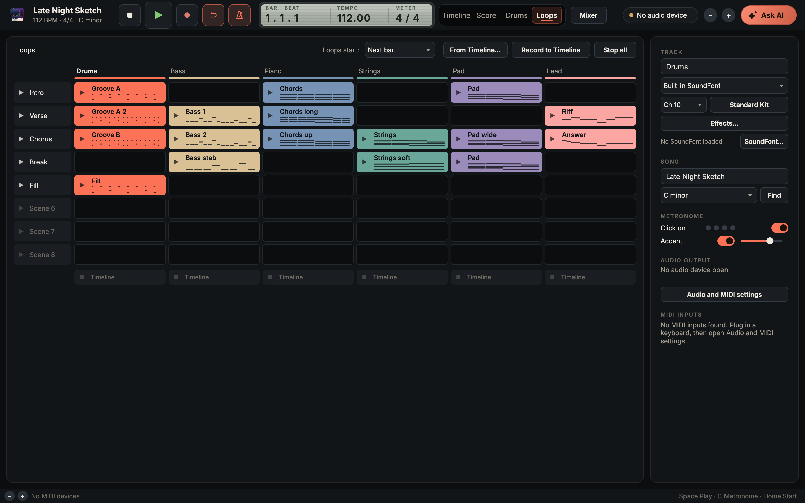

# Lazy Arranger Midi DAW

Lazy Arranger Midi DAW is a MIDI arranger DAW with AI assist. Compose, arrange, score and perform in one desktop studio.

[Download the latest public release](https://github.com/nhth-mibu/lazy-arranger-midi-daw-releases/releases/latest).

## Download

Open [Releases](https://github.com/nhth-mibu/lazy-arranger-midi-daw-releases/releases)
and choose the latest release. Each release includes:

- **macOS:** `ArrangerMidiDaw-macos-universal.dmg` (arm64 and x86_64).
- **Windows:** `ArrangerMidiDaw-windows-x64.zip`.
- **Linux:** `ArrangerMidiDaw-linux-x64-ubuntu-26.04.tar.gz`.
- The Arranger Demo Styles ZIP when a release includes it.
- A `.sha256` file for each package.

Check a package before opening it:

```sh
shasum -a 256 -c ArrangerMidiDaw-macos-universal.dmg.sha256
```

The macOS app is ad-hoc signed, not Developer ID signed or notarized. Windows
needs the Microsoft Visual C++ v14 x64 Redistributable. The Linux package targets
Ubuntu 26.04 x64. The packages do not include a General MIDI SoundFont.

The application source code is private. This public repository holds the
documentation and the binaries only. GitHub's "Source code" archives for its
tags contain only these public files, not the application source.

## Timeline

Make the song. Record MIDI and audio, edit notes in the piano roll, comp takes and crossfade clips. Move sections, loop a range, quantise, split and join clips. Draw automation for volume, pan, sends and any plugin control. Analyse audio into stems, notes, chords, instruments and lyrics.



## Score

Turn the music into printed notation. Read and write full scores, grand staves and drum staves. Enter notes with the mouse, the computer keyboard or a MIDI keyboard. Add chord symbols, lyrics, dynamics and articulations. Find chords from the notes. Print the score or export PDF, and exchange MusicXML with other notation programs.



## Drums

Build a drum pattern step by step. Choose the step size and pattern length, set each hit, and repeat the pattern through the song. Cut, copy and paste rows or whole patterns. Play a pattern from one bar to another on the same track or on a new drum track.



## Loops

Try arrangements before you commit. Launch clips and scenes in time, combine tracks, and record the performance to the Timeline. Turn Timeline sections into scenes. Load Yamaha styles or Korg styles saved in the SFF format. Play their sections with chords. Write a section onto Timeline tracks.



## AI assist

Ask the assistant for changes in plain words: add a track, write notes, find
chords, or fill a section from a style. Each change is one undo step.

- **Skills:** recipes and data that the assistant can load. The built-in
  **Common chord progressions** skill covers pop, rock, jazz and blues. Add
  your own JSON skill packs in the app's `Skills` folder, without rebuilding
  the app. See [Skills](docs/user-manual.md#skills).
- **Speech input:** click the **microphone** button in the AI chat, speak, then
  click it again. The built-in Whisper writes the words into the message box.
  Voice input needs a Whisper model from `Options > Audio Analysis Tools...`.
- **Text to speech (TTS):** click the **speaking person** button to speak every
  complete AI reply once. Use the system voice, or install the offline Kitten or
  Kokoro voice in `Options > Speech...`. See [Speech](docs/user-manual.md#speech).

The speech buttons are in the chat panel. They are global switches, not buttons
on each message.

## More

- **Audio:** WAV, AIFF, FLAC, Ogg and, on macOS, MP3 and M4A. Record to WAV, follow the song tempo, and analyse audio into parts.
- **Instruments:** the built-in SoundFont player, the drum sampler, VST3 and Audio Unit instruments.
- **Effects:** VST3 and Audio Unit effects on tracks, buses and the master.
- **Mixer:** balance tracks, buses and the master with volume, pan, sends, mute and solo.
- **Automation:** volume, pan, reverb send, chorus send and plugin controls.
- **Styles:** open and save Yamaha `.sty` and `.prs` files. Load Korg styles saved in the SFF format.
- **Files:** MIDI, MusicXML, SoundFont and `.arranger` projects.

## Works with

- Yamaha arrangers
- Korg Pa arrangers (GM bank)
- MIDI controllers
- MIDI mixers

Tested with the Yamaha PSR-S970, Novation Launchkey Mini MK3, Behringer X-Touch Mini, Roland D-05 and Novation XioSynth 49. Other models were not tested.

## Learn more

- [Feature sheet](docs/Arranger-MIDI-DAW-Feature-Sheet.pdf) ([Word](docs/Arranger-MIDI-DAW-Feature-Sheet.docx))
- [User manual](docs/user-manual.md)
- [Device profiles](docs/device-profiles.md)
- [Controller pages](docs/controllers.md)
- [Public releases](https://github.com/nhth-mibu/lazy-arranger-midi-daw-releases/releases)
