# Lazy Arranger Midi DAW user manual

This manual tells you how to use Lazy Arranger Midi DAW. The app is a desktop
studio for arrangers. You write songs with styles and chords, the AI helps you
with the arrangement, and you play the song on your keyboards and synths. The
manual includes only the functions that the app has now.

On Windows and Linux, use the `Ctrl` key where the manual says `Cmd`.

## What the app can do

These are the main functions of the app. Each item has a link to its section.

- **Arranger styles.** Open Yamaha and Korg styles. Fill tracks from a style.
  The parts follow the chords of the song. Change a style and save it. See
  [Styles](#styles).
- **Songs for the keyboard.** Export the song for the Yamaha PSR-S970. Each
  track gets a keyboard voice. See
  [Play your song on the PSR-S970](#play-your-song-on-the-psr-s970).
- **A style from a recording.** Give the app an audio file or a link. The app
  makes a style that you can play on the keyboard. See
  [Style from Audio](#make-a-style-from-a-recording-style-from-audio).
- **Take a recording apart.** The app finds the stems, notes, chords and lyrics
  of a song. When a place is not clear, the app asks you. See
  [Take a recording apart](#take-a-recording-apart-stems-notes-chords-lyrics)
  and [Check the transcription](#check-the-transcription-the-app-asks-you).
- **AI chat.** Ask for a change in plain words. The assistant changes the
  song. Each change is one undo step. Other AI programs can connect to the app
  with MCP. See [Talk to the app](#talk-to-the-app-ai-assistants).
- **Arranging help.** The Arrangement Doctor finds problems in the arrangement
  and proposes fixes. Fit to My Synths makes the song fit your synths. See
  [Arranging help](#arranging-help).
- **Groove.** Put the feel of one part, a file or some words on other parts.
  See [Groove](#groove).
- **Song Forms.** Make a short version, a long intro, a gig version or a solo
  break of the song. See [Song Forms](#song-forms).
- **Smart chords.** Type chords, play chord pads, record the chords that you
  play, and reharmonize a bar. See [Smart chords](#smart-chords).
- **Score.** See and print the song as music, with chords and lyrics. See
  [Score view](#score-view).
- **Your synths and controllers.** The app turns on each keyboard and
  controller that you connect. It knows the sounds of your synths and has sound
  editors for some of them. See [Your synths](#your-synths) and
  [Hardware controllers](#hardware-controllers).
- **Kids Mode.** A child presses keys and the song plays. See
  [Kids Mode](#kids-mode).

The app also has all the usual functions of a DAW: MIDI and audio tracks,
drum patterns, a slicer, a clip grid, a mixer, automation and plugins.

## Words in this manual

| Word | Meaning |
| --- | --- |
| Track | One instrument part. A track has an output, a sound and mixer controls. |
| Clip | A block of notes on a track. |
| Audio clip | A block on an audio track that plays an audio file. |
| Output | The place where a track plays: the built-in SoundFont player, a plugin or a MIDI port. |
| Automation | A line that changes a value of a track while the song plays: the volume, the pan, a send or a control of a plugin. |
| Bus | A mixer channel that mixes the sound of more tracks. It has its own effects and fader. |
| MCP | Model Context Protocol: the way AI assistants connect to programs. |
| Send | A part of the sound of a track that also goes to a bus. |
| Plugin | Software from a different maker that makes or changes sound in the app (VST3 or Audio Unit). |
| MIDI port | A connection to a keyboard, synth or controller. |
| SoundFont | An SF2 file that contains instrument sounds. |
| Playhead | The vertical line that shows the song position. |
| Loop | The part of the song that plays again and again. |
| Device profile | A file that tells the app the sounds of one synth. |
| Kit | The set of samples on a `Drum sampler` track. |
| Pad | One sample in a kit. A pad plays when its note plays. |
| Pattern | A short clip that repeats. You make patterns in the Beat view. |
| Slot | One box in the Clip grid. A slot can contain one clip. |
| Scene | One row of slots in the Clip grid. |
| Style | An accompaniment for an arranger keyboard. Its parts follow the chord that you play. |
| Section | One part of a style in time, for example `Main A`. A section is a scene. |
| Score | The notes of a track as printed music. |
| Grand staff | Two staves joined by a brace: treble clef above, bass clef below. Piano music uses it. |

## Quick start

1. Open the app.
2. Select `Options > Audio and MIDI Settings...`.
3. Select your audio output. Connect your MIDI keyboard. The app turns on its
   input. A dot in the bottom bar comes on when you play.
4. Get sounds for the built-in instrument. The first time you start the app,
   it asks to download GeneralUser GS (free, 32 MB). Click `Download`.
   To do this later, select `File > Download GM SoundFont...`.
   To use your own SF2 file, select `File > Choose SoundFont...`.
5. Play your keyboard. You hear the sound of the selected track.
6. Push `R` to record. Play some notes.
7. Push `Space` to stop. The app makes a clip with your notes.
8. Push `Space` again to hear the clip.

## Autosave and crash recovery

The app keeps a copy of your unsaved changes. It writes the copy one minute
after a change, and again each minute while you make more changes. When you
save the project or quit the app, it removes the copy.

If the app or the computer stops before you save, the app asks at the next
start: `Recover unsaved work?`

- Click `Recover` to open the copy. The title shows `*` because the work is
  not saved yet. Select `File > Save` to keep it. If the work came from a
  project file, Save writes to that file.
- Click `Discard` to delete the copy.
- Click `Later` to keep the copy. The app asks again at the next start.

The copies are in the `Autosave` folder next to the app settings
(`~/Library/Application Support/Arranger MIDI DAW/Autosave` on macOS,
`%APPDATA%\Arranger MIDI DAW\Autosave` on Windows,
`~/.config/Arranger MIDI DAW/Autosave` on Linux). The app deletes copies that
are older than 30 days.

Note: the copy has the plugin settings from the last time you closed a plugin
window or saved.

## Demo songs

The `examples` folder has two demo songs:

- `Copper Lights`: EDM, 126 BPM, A minor.
- `Northern Fire`: slow rock ballad, 72 BPM, E minor. The `Vocal` track has the
  melody and the lyrics. Its volume is 0. Open the Score to see the lyrics.

Each song is in a folder with these files:

- `<song> (MIDI).arranger`: MIDI tracks that play through the built-in SoundFont player.
  Change notes and sounds as you like.
- `<song> (Audio).arranger`: the same song, with each track as an audio file.
  Use it to try mixing, effects and audio editing.
- `<song>.mid`: the General MIDI file. It plays on most keyboards and synths.
  Keyboards that show MIDI lyrics (such as the PSR-S970) show the lyrics of `Northern Fire`.

## Lyrics in MIDI files

When you import a MIDI file, the app puts its lyric events in the Score under the notes.
When you export a MIDI file, the app writes the lyrics of the Score as lyric events.

## The main window

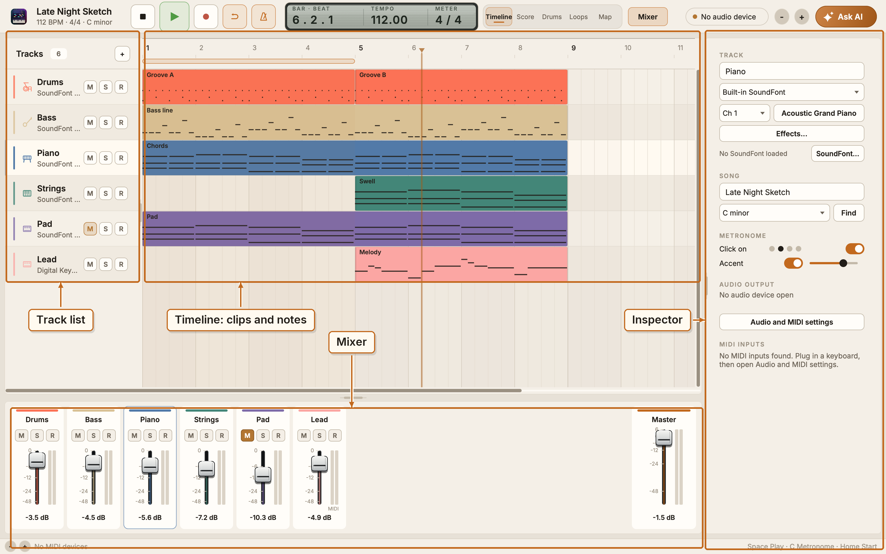

- **Top bar:** transport buttons, the position display, the tempo, the meter and the view tabs.
- **Left:** the track list.
- **Centre:** the timeline with the clips. The note editor opens below it.
- **Top, tabs:** `Timeline`, `Score`, `Drums`, `Loops` and `Map` show the different views.
- **Bottom:** the mixer panel. It stays under each view. The `Mixer` button shows or hides it.
- **Right:** the inspector. It shows the selected track, the song, the metronome and your devices.
- **Panel edges:** drag the divider on the right of the track list to set its width. When the AI panel is open, drag the bar above it to set its height. The app remembers both.
- **Bottom bar:** the MIDI inputs. A dot comes on when a message arrives.

## Tracks

### Add a track

Click `+` above the track list and select `MIDI Track` or `Audio Track`. `Cmd+T` adds a MIDI track.

For audio tracks, refer to [Audio tracks](#audio-tracks).

### Set the output and the sound

1. Click the track.
2. In the inspector, select the output: `Built-in SoundFont`, `Drum sampler` or a MIDI port.
3. Select the MIDI channel. Use channel 10 for drums on most devices.
4. Click the sound button and select a sound.

The sound list comes from the SoundFont or from the device profile of the
MIDI port. If the app has no profile for the port, it shows the General MIDI
sounds.

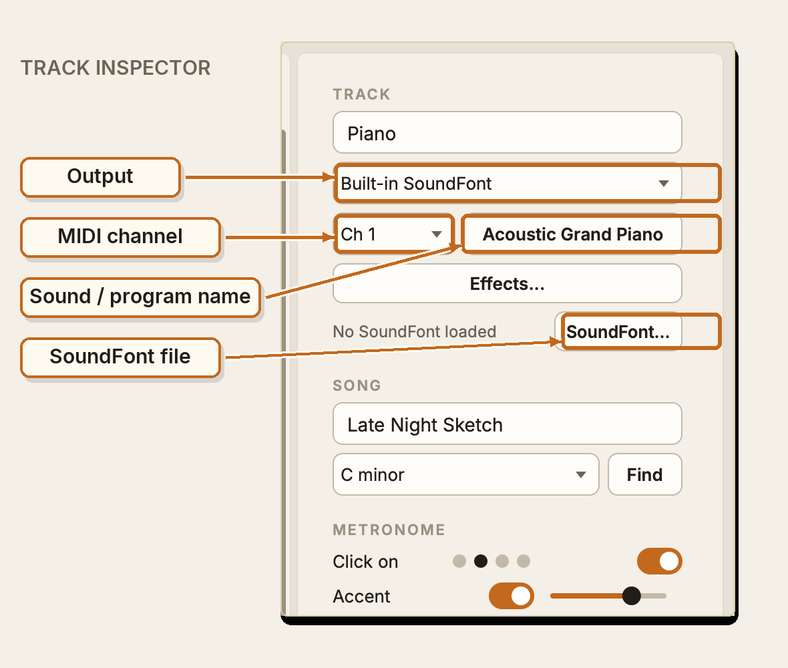

For the built-in SoundFont, the sound button shows the name of the program,
for example `Acoustic Grand Piano` or `Standard Kit`. It uses the name from
the loaded SoundFont, or the General MIDI name when the app has no SoundFont.

### Change a track

- To rename a track, double-click its name.
- To move, duplicate, colour or delete a track, right-click the track.
- `M` mutes the track. `S` plays only this track. `R` arms the track for recording.

## Play and record

| Action | Key |
| --- | --- |
| Play or stop | `Space` |
| Go to the start | `Home` or `Enter` |
| Record | `R` |
| Loop on or off | `L` |
| Metronome on or off | `C` |

- When the song stops, the app ends all notes on the synths that the song uses.
- If a note continues to sound, click the stop button again. The playhead goes to the start, and the app sends "All Sound Off" and "All Notes Off" to all synths that the song uses.
- To move the playhead, click the top half of the ruler.
- To set the loop, drag in the bottom half of the ruler.
- To change the tempo, drag the tempo value or double-click it.
- To change the meter, click the meter value.

### Record

1. Arm a track with `R` in the track list. If no track is armed, the app records on the selected track.
2. Push `R` on your computer keyboard. Playback and recording start.
3. Play your part.
4. Push `Space` to stop.

The app makes a new clip. The clip starts and ends on bar lines. To quantise
each recording automatically, select `Edit > Quantise While Recording`.

### Choose the keyboard of a track

The track plays and records the MIDI from all keyboards. To use one keyboard
or one MIDI channel only:

1. Open the mixer (`Cmd+2`).
2. Right-click the name of the track.
3. Select `MIDI Input` and then the keyboard. To use one channel only, select `MIDI Input > Channel`.

Controllers with a mixer layout (for example the X-Touch Mini) are not in the
list. Their knobs and faders control the mixer.

## Clips

| To do this | Do this |
| --- | --- |
| Add an empty clip | Double-click an empty area of a track |
| Select a clip | Click it. Drag on an empty area to select more than one. |
| Move a clip | Drag it. You can drag it to a different track. |
| Change the length | Drag the right edge |
| Duplicate | `Cmd+D` |
| Cut, copy or paste | `Cmd+X`, `Cmd+C` or `Cmd+V`. You can also right-click. |
| Split at the playhead | `Cmd+E` |
| Join clips | Right-click and select `Join` |
| Delete | `Delete` |
| Open the note editor | Double-click the clip |

Each coloured part is a clip. The small lines inside a clip are its notes.
Drag the right edge to change the length, or double-click the clip to edit its
notes.

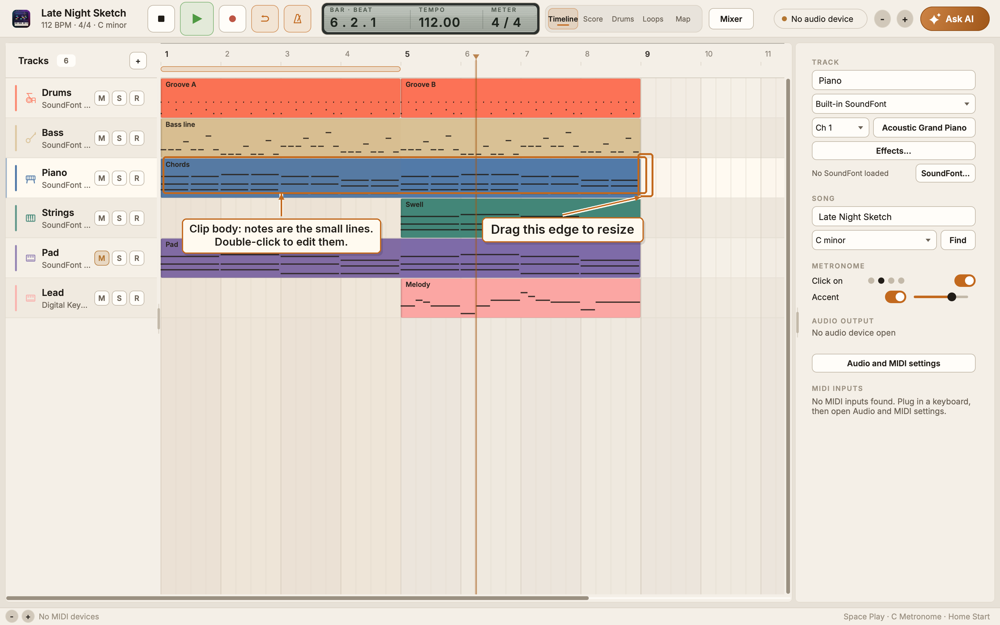

Clips snap to bars or beats. Hold `Alt` to move a clip freely.

## Cut, copy and paste

You can cut, copy and paste in all views. Use the `Edit` menu, the keys, or
right-click.

| To do this | Push |
| --- | --- |
| Cut | `Cmd+X` |
| Copy | `Cmd+C` |
| Paste | `Cmd+V` |

The app keeps one copy at a time: clips, notes or automation points. Paste
puts the earliest item at the place. The other items keep their positions
after it.

| In this view | Copy takes | `Cmd+V` pastes |
| --- | --- | --- |
| Timeline | The selected clips (MIDI and audio), or the selected automation points | At the playhead, on the selected track |
| Note editor | The selected notes | At the playhead, in the open clip |
| Score | The selected notes | At the playhead, on the track of the score. With note input on, at the input cursor. |
| Beat | The full pattern | At the start of the pattern, in place of its notes |
| Clip grid | The clip in the slot that you clicked last | In the slot that you clicked last, in place of its clip |

If you right-click and select `Paste Here`, the paste goes to the mouse
position.

More rules:

- Clips that you copy from more than one track go on the same number of tracks, from the selected track down.
- An audio clip goes only on an audio track. A MIDI clip does not go on an audio track.
- Notes that you paste on the Timeline go into the clip at that place. If there is no clip, the app makes a new clip.
- Notes from the Timeline can go into a Clip grid slot. The app makes a clip of full bars.

Use the scrollbar at the bottom to move along the song, and the scrollbar at
the right to move through the tracks. To zoom time, hold `Cmd` and turn the
mouse wheel. On a trackpad, pinch. To zoom the track height, hold
`Cmd+Shift` and turn the mouse wheel, or click `-` and `+` above the track
list.

## Audio tracks

An audio track plays audio clips. An audio clip plays one audio file, or a part of it.
The clip shows the sound of the file as a wave.

The app does not change your audio files. A clip only tells the app which part of the file to play.

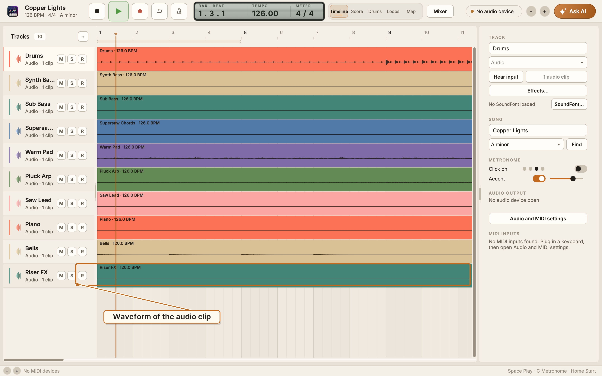

### Audio files that the app reads

| File type | Where |
| --- | --- |
| WAV, AIFF, FLAC, Ogg Vorbis | On all computers |
| MP3, M4A (AAC), CAF | On macOS |
| Audio from MP4, MOV, MKV, WebM, AVI, WMV and MPEG video | With FFmpeg installed |

The same file types work for audio clips, audio loops, drum samples and the slicer.
The app reads the complete file into memory. A file that is not a WAV file can be a maximum of 45 minutes long.

### Add an audio file

1. Select `File > Import Audio File...`.
2. Select an audio file.

The app puts the clip at the bar of the playhead. If the selected track is not an audio track, the app makes a new audio track.

You can also drag audio files from the Finder to the Timeline, or double-click an empty place on an audio track. The clip then starts at that bar.

### Import audio from a video

1. Put the FFmpeg executable on your system PATH or beside the app executable. On macOS, the app also checks `/opt/homebrew/bin` and `/usr/local/bin`.
2. Select `File > Import Audio File...` and select the video. You can also drag the video to the Timeline.

The app reads the first audio stream as stereo audio at 48 kHz. The video must contain an audio stream that FFmpeg can decode. Audio can be up to 45 minutes long. An import stops with an error if decoding takes more than two minutes.

The audio clip refers to the original video file. Keep that file available when you reopen the project. The app reads its audio once per session and keeps it in memory. Temporary decoding files are removed after import.

### Record audio

1. Connect your microphone or instrument to the audio input of your computer or audio interface.
2. Click `Audio and MIDI settings` and select the input. Do this one time only.
3. Click `+` above the track list and select `Audio Track`.
4. Arm the audio track with `R` in the track list.
5. Push `R` on your computer keyboard. Playback and recording start.
6. Play or sing your part.
7. Push `Space` to stop.

The app saves the recording as a 24-bit WAV file and puts a clip on the track.
If the project has a file, the WAV file goes into a folder next to it. The folder has the name of the project and the word `Audio`.
If the project has no file yet, the WAV file goes into `Music/Arranger MIDI DAW/Recordings`.

### Choose the input

An audio track records from the first two inputs of the audio device. To use
another input:

1. Select the audio track.
2. Click `Input:` in the inspector.
3. Select the input. A stereo input records a stereo file. A mono input records a mono file.

The app opens the input in `Audio and MIDI settings` if it is closed.
For a Zoom LiveTrak L6max in Multi Track mode, the list shows the names of
its channels: `CH1` to `CH8` and `MASTER`.

### Import an L6max recording

The Zoom LiveTrak L6max records each channel to its microSD card.

1. Copy the project folder (`RECORDER` > `yymmdd_hhmmss`) to your computer.
2. Select `File` > `Import L6max Recording...`.
3. Select the project folder.

The app adds one audio track for each channel, at bar 1. It uses the last
take of each channel. The `Master` track is the L6max stereo mix. It starts
muted.

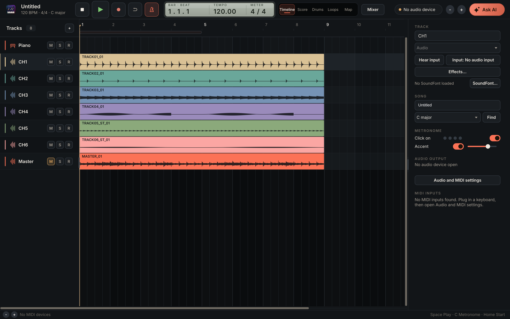

### Hear the input

1. Select or arm the audio track.
2. Click `Hear input` in the inspector.

You hear the audio input together with the song. The switch works while the track to record on is an audio track. It is not part of the project.

Use headphones when `Hear input` is on. With speakers, the microphone hears the speakers and you get a loud feedback tone.

If you hear the input too late, make the buffer size smaller in `Audio and MIDI settings`.

The first time, macOS asks for permission to use the microphone. Click `OK`.

### Change audio clips

You move, duplicate, split and delete audio clips the same way as other clips. Refer to [Clips](#clips).
An audio clip stays on audio tracks.

| To do this | Do this |
| --- | --- |
| Play less of the file | Drag the right edge of the clip to the left |
| Cut a clip in two | Put the playhead on the place and push `Cmd+E` |
| Make the clip louder or quieter | Right-click the clip and select `Gain` |
| Fade the start or the end | Right-click the clip and select `Fade in` or `Fade out` |

The track volume, pan, mute and solo in the Mixer work for audio tracks too.

### Takes and crossfades

When audio clips on one track overlap, only the clip on top plays. A new recording or a new file goes on top of the clips below it. Each recording over the same place is a take.

At each edge of the clip on top, the two clips cross over in a short crossfade, so you hear no click. For a longer crossfade, give the clip on top a fade in or a fade out. The crossfade is as long as the fade.

To choose the take that plays:

1. Right-click the clips at the place.
2. Select `Takes Here` and select the take.

You can also right-click a clip and select `Bring to Front`.

To make one part from the best parts of more takes (comping):

1. Select all the takes.
2. Put the playhead where one take must stop and the next take must start.
3. Push `Cmd+E`. All the selected takes are cut at the playhead.
4. For each part, right-click it and select the take that plays.

### Make a loop follow the song tempo

Usually an audio clip plays at the speed of its file. A drum loop at 100 BPM does not fit a song at 120 BPM.

1. Right-click the clip.
2. Select `Follow Song Tempo`.

The app calculates the tempo of the file from its length. Then it plays the file faster or slower, and the pitch stays the same.
The clip shows the file tempo after its name.

If the tempo is wrong, right-click the clip, select `Set File Tempo...` and type the tempo of the file.

To stop this, select `Follow Song Tempo` again.

A large tempo change can make the sound rough. Drum loops and single instruments give the best results.

### Convert audio to MIDI

The app can find the notes in an audio clip and write them as a MIDI clip.

1. Right-click the audio clip.
2. Select `Convert to MIDI`.
3. Select `Melody (one note at a time)` or `Drums (kick, snare, hi-hat)`.

The app makes a new track below the audio track. The new track contains a clip with the notes.

- `Melody` is for a voice, a bass or a lead line. It does not find chords.
- `Drums` writes each hit as a kick, a snare or a hi-hat. Other drums become one of these three.

Examine the result in the note editor and correct the wrong notes.

### Take a recording apart (stems, notes, chords, lyrics)

The app can split a full song into parts and write each part as MIDI. All of the work is done on your computer.

1. Right-click the audio clip and select `Analyse Audio (Stems, Chords, Lyrics)...`. You can also select the clip and then select `Track > Analyse Audio...`.
2. Select what the app must find:
   - `Stems`: the vocals, drums, bass and other music, each on a new audio track.
   - `Notes`: a MIDI track for each stem.
   - `Chords`: chord symbols on the score.
   - `Instruments`: the names of the instruments that play. Each MIDI track gets a General MIDI sound that fits.
   - `Lyrics`: the sung words, under the notes of the vocal track.
3. For lyrics, select the language. You can also type the song title or some of the words. This helps Whisper.
4. Select `Analyse`.

The original track is muted when stem tracks are added. Select `Undo` to remove all of the new tracks.

Before the first analysis, set up the tools one time:

- Select `Install Tools...` in the same window, or `Options > Audio Analysis Tools...`. The app downloads Demucs, Basic Pitch and PANNs (1 to 2 GB). This takes some minutes.
- For lyrics, select a Whisper model and select `Download`. `Large turbo` gives the best words for songs.

Chords do not need the tools.

Whisper often hears sung words incorrectly. To correct them, select `Fix Lyrics with AI` after the analysis. The AI chat reads the words and corrects them. You can also correct a word in the Score.

The AI assistant can also start an analysis: for example, "take the audio clip apart and put the lyrics on the score".

### Check the transcription (the app asks you)

Some places in a recording are not clear. For example, the bass can play E or A. The app finds these places after an analysis and asks you. You listen and choose.

1. After the analysis, select `Check the Chords` in the analysis window. You can also select `Track > Check the Transcription...` or `AI > Check the Transcription...`.
2. The AI panel shows a card for each place, the most useful first. Each card has two choices:
   - `A` is what the analysis found.
   - `B` is the other possible bass note or chord.
3. Select `Original` to hear the recording at that place. Select `Play A` or `Play B` to hear the recording with a guide: a piano chord and its bass note. The place plays in a loop.
4. Select `Use` below the choice that you hear.

When you use a choice:

- The chord symbol at that place changes.
- The bass notes on the old bass note move to the new note. Other notes do not change.
- The app keeps your answer in the analysis. The app does not ask about that place again. `Style from Audio` uses your answer.

`Same answer in similar places` is on by default. Then one answer also changes the other places with the same two choices.

Select `Undo` to take back the change in the song. Select `Dismiss` to hide a card without an answer.

The first version asks about the bass note and the chord root only. The numbers on a card compare the two choices. They are not chances. With stems, the app uses the bass stem and finds more. Without stems (chords only), the app asks only when the other choice fits better.

The AI assistant can ask the questions too: for example, "check the chords of the analysis with me".

## Drum sampler

A `Drum sampler` track plays your audio files. Each file is a pad.

### Make a kit from samples

1. Click the track.
2. In the inspector, set the output to `Drum sampler`.
3. Click `Load samples...`.
4. Select `Load samples...` and select one or more audio files.

The app gives each file a pad. The first pad plays on note C1 (36). The
subsequent pads use the subsequent notes.

To hear, change or remove a pad, click the kit button and select the pad.

A choke group stops a sound when a different sound starts. For example, put
the open hi-hat and the closed hi-hat in the same choke group.

The project file keeps the location of each audio file, not the sound. Do not
move or delete the audio files.

### Slice a loop

The slicer cuts a drum loop into pieces. Each piece becomes a pad.

1. Click a track.
2. Click the kit button (or the sound button) in the inspector.
3. Select `Slice a loop...` and select an audio file.
4. Select how to cut the loop:
   - `Slice at each hit`: the app finds each drum hit. Move the slider to get more or fewer slices.
   - `Slice in equal parts`: select the number of parts.
   - `Slice by hand`: double-click the waveform to add or remove a marker.
5. Click a slice to hear it.
6. Select the length of the loop in bars.
7. Click `Make a clip that plays the loop`.

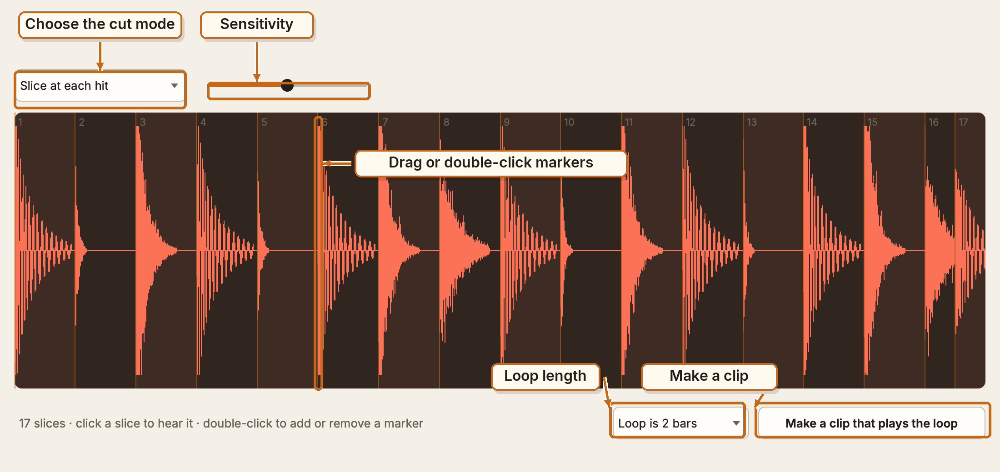

The app makes a clip that plays the slices in sequence. The loop now follows
the tempo of the song. You can move the notes of the clip to change the
rhythm.

## Beat view

The Beat view is a step sequencer for the selected track. Each row is a drum
sound. Each column is a step. The steps stay square: resize the window to
make them larger or smaller. Use the scrollbars to move across the grid, or
hold `Cmd` and turn the mouse wheel to resize the steps.

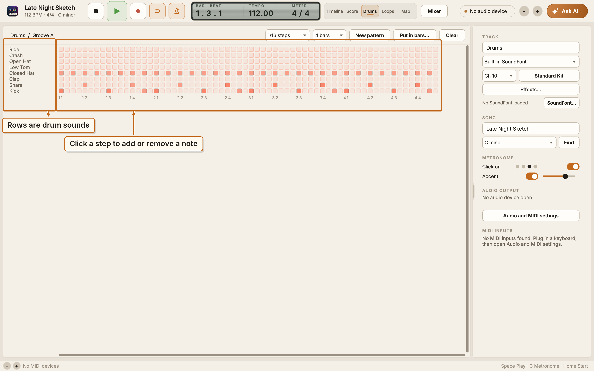

1. Click a drum track.
2. Click the `Beat` tab, or push `Cmd+4`. You can also double-click a clip on a drum track.
3. Click `New pattern on this track`.
4. Click a step to add a note. Click it again to remove the note.

| To do this | Do this |
| --- | --- |
| Add many steps | Drag along a row |
| Make a step soft, normal or loud | Right-click the step |
| Change the step length | Select a value in the steps box, for example `1/16 steps` |
| Change the pattern length | Select 1, 2, 4 or 8 bars |
| Remove all notes | Click `Clear` |
| Resize the steps | Hold `Cmd` and turn the mouse wheel |
| Copy or paste a row or the full pattern | Right-click the name of a row |
| Play the pattern from one bar to another | Click `Put in bars...`. Type the first bar and the last bar. |
| Make a new drum track with the pattern | Click `Put in bars...` and select `On a new drum track` |

A long drum clip, for example from a MIDI file, shows the whole pattern from
bar 1. Scroll sideways when the pattern is wider than the view. The steps stop
at a usable minimum width, so a long part stays readable.

While the Beat view is open, only the selected track plays. The other tracks
are silent. When you go to a different view, all tracks play again.

A pattern is a clip that repeats. In the Timeline, drag the right edge of the
clip to make the pattern play for more bars.

For a `Drum sampler` track, the rows are the pads of the kit. For other
tracks, the rows are the General MIDI drum sounds.

## Clip grid

The Clip grid lets you play clips as loops and try different combinations.
Each column is a track. Each row is a scene. Each box is a slot.

To open the Clip grid, click the `Clips` tab or push `Cmd+5`.

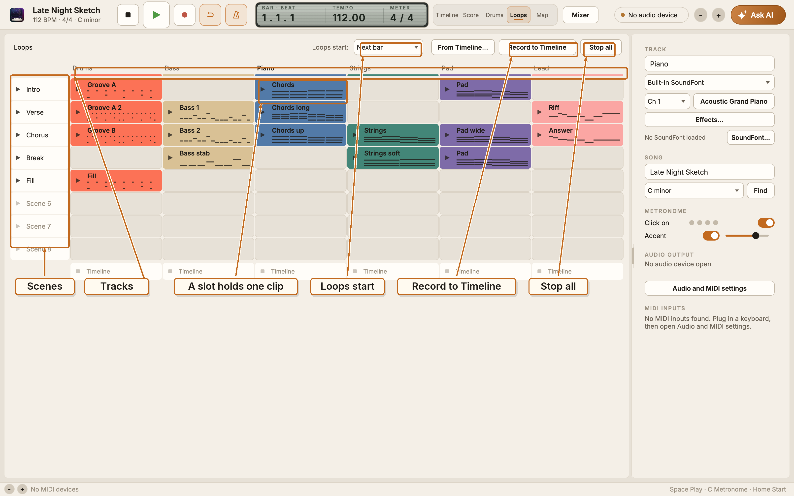

### Put the Timeline in the Clip grid

The Timeline and the Clip grid are two different places for clips. A new
song has an empty Clip grid. To put the clips of the Timeline in the Clip grid:

1. Click `From Timeline...`.
2. Select the number of bars in each scene, for example `4 bars`.
3. Click `Fill`.

The app cuts the song into parts. Each part becomes a scene, with a name
such as `Bars 5-8`. Each MIDI track gets a clip in each scene where it plays.
Audio tracks do not change. Use Undo to take it back.

### Put clips in slots

| To do this | Do this |
| --- | --- |
| Make an empty clip | Double-click an empty slot. The note editor opens. |
| Copy a clip from the Timeline | Select the clip in the Timeline. Then right-click an empty slot and select `Copy from the Timeline`. |
| Edit the notes | Double-click the clip |
| Change the length | Right-click the clip and select `Length` |
| Rename, copy or delete | Right-click the clip |
| Cut, copy or paste | Click the slot, then push `Cmd+X`, `Cmd+C` or `Cmd+V`. You can also right-click the slot. |
| Rename a scene | Double-click the scene name |
| Resize the slots | Hold `Cmd` and turn the mouse wheel |

To edit a slot clip as a drum pattern, open its notes and then click the
`Beat` tab.

### Put audio loops in slots

The slots of an audio track hold audio loops.

1. Add an audio track, or use one that you have.
2. Double-click an empty slot of the audio track.
3. Select an audio file.

The slot shows the name of the file and a small picture of its sound.

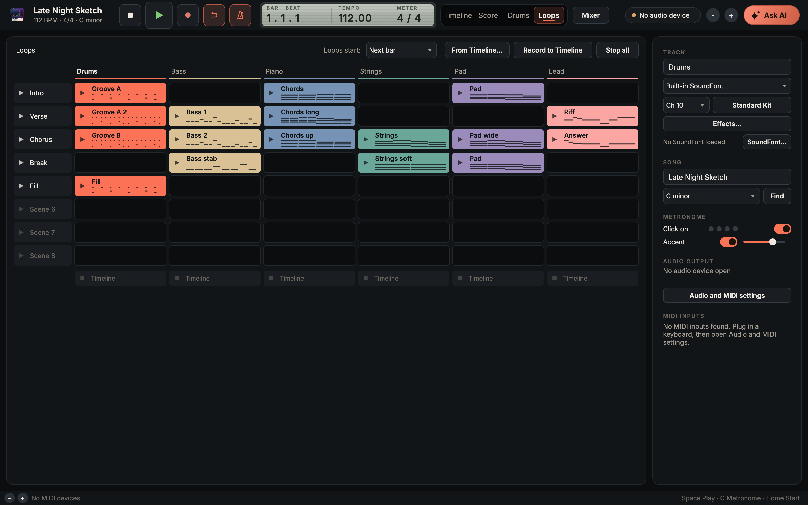

- The app finds the tempo of the loop from its length. The loop then follows the tempo of the song.
- The loop is a number of full bars. To change the number, right-click the slot and select `Loop length`.
- To play the file at its own speed, right-click the slot and remove the tick at `Follow the song tempo`.
- To use a clip from the Timeline, select it, then right-click an empty slot and select `Copy from the Timeline`.
- To remove the loop, right-click the slot and select `Delete`.

An audio loop starts and stops as the other clips do. While a slot plays, the
audio clips of that track on the Timeline are silent.

### Play clips

- To start a clip, click the play button on the clip.
- To start all clips in a row, click the scene name.
- To stop one track, click `Stop` below its column, or click the stop button in an empty slot.
- To stop all clips, click `Stop all`.

A clip does not start immediately. It starts at the subsequent bar, thus all
clips stay in time. To change this, select a different value in `Clips start`.

If the song is stopped, the first clip starts at once. The playhead moves back
to the start of its bar, thus the clips that you start after it stay in time.

A clip that waits flashes. A clip that plays shows a progress line.

A track plays one slot at a time. While any slot is active, the Clip grid
takes over the song and the whole Timeline is silent. When all slots stop, the
Timeline plays again.

### Record the Clip grid to the Timeline

1. Click `Record to Timeline`.
2. Start clips and scenes.
3. Click `Record to Timeline` again, or push `Space`.

The app writes all that you played to the Timeline as clips. The slots stop,
and the Timeline plays your recording.

### Record notes into a slot

1. Start the clip in the slot.
2. Push `R` and play your keyboard.
3. Push `R` again.

The app adds your notes to the clip in the slot.

## Smart chords

The chord lane is the row under the bar numbers on the Timeline. It shows the chord symbols of the song. The Score, Style Fill and the AI tools use the same chords.

### Type chords

1. Double-click the chord lane at a bar. A chord box opens.
2. Type chord names or roman numerals, for example `Am F C G` or `vi IV I V`.
3. Push Enter.

Without `|`, each chord is one bar. `|` ends a bar, and the chords in that bar share it: `Am F | C G` is two bars. `%` repeats the bar before. `/` holds a chord.

Under the box, the app shows the next chords to try. Click one to add it. Right-click the chord lane for more: the next chord for a bar, Reharmonize, Delete, and Find Chords from the Music.

### The Smart Chords panel

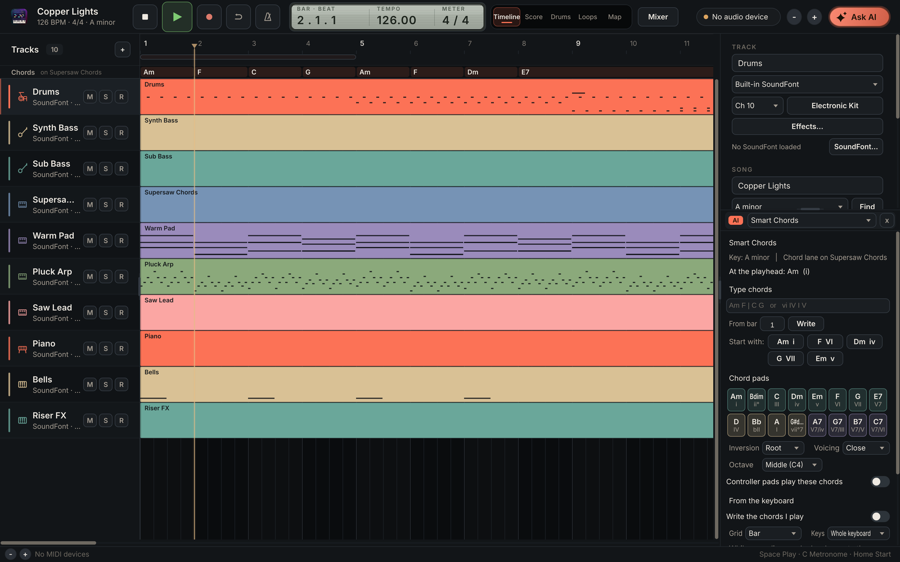

Open it with AI > Smart Chords (Cmd+Shift+K). It has four parts:

- **Type chords**: the same typing, with the next chord ideas and the bar to start from.
- **Chord pads**: 16 chords for the song key. Teal pads are the chords of the key. Amber pads are borrowed from the other mode (major or minor). Violet pads are secondary dominants. Press a pad to hear the chord on the selected track. Set the inversion, the voicing and the octave under the pads. "Smooth" voicing moves the notes as little as possible.
- **From the keyboard**: turn on "Write the chords I play". While you record, each chord you play goes to the chord lane at the grid (a bar, half a bar or a beat). When the song is stopped, the chord goes to the lane at the playhead when you release the keys, and the playhead moves on. "Left hand" uses only the keys below the split point, as on an arranger keyboard.
- **Reharmonize**: put the playhead on a chord and click Reharmonize. The app shows other chords (for example a tritone substitute, a borrowed chord or a ii-V into the next chord). Each option also moves the chord and bass parts. The melody and the drums do not change. Click Play A, Play B and Original to compare. Click Use to keep one. Undo removes it.

### Chord pads on the Launchkey

Turn on "Controller pads play these chords". The 16 pads of the Launchkey Mini MK3 play the chord pads, in place of the Clip grid. Knob 1 sets the inversion, knob 2 the voicing and knob 3 the octave. Turn the switch off to use the pads for clips again.

## Kids Mode

Kids Mode is for pretend play. A child presses keys and the song plays, as if the child plays it.

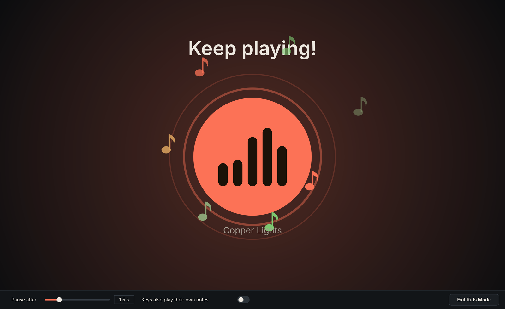

1. Open a song.
2. Choose Transport > Kids Mode (Cmd+Alt+K).
3. Press any key on any MIDI keyboard (the PSR-S970, the Launchkey keys or pads). The song plays.
4. Stop pressing keys. After the wait, the song pauses.
5. Press a key again. The song goes on from where it paused. At the end, it starts again from the top.

A large circle shows the state. It is copper and moves while the song plays. Computer keys and a click on the circle also play the song.

The bar at the bottom is for adults:

- **Pause after**: the wait before the song pauses, from 0.5 to 5 seconds. The default is 1.5 seconds. A held key keeps the song playing.
- **Keys also play their own notes**: off by default, so that the keys only play the song. Turn it on to also hear the notes on the track you record on.
- **Exit Kids Mode**: go back to the normal window. Cmd+Alt+K also does this.

The app remembers these settings.

Note: a keyboard with its own speakers (the PSR-S970) also plays its own notes. To make the keys silent, set Local Control to Off on the keyboard, or turn its volume down.

## MIDI Map

The `Map` tab shows the tracks in the current bank by every app control. Use
it to see or change which knob, button, pad or fader drives each cell. The
`<` and `>` buttons move the bank by 8 tracks.

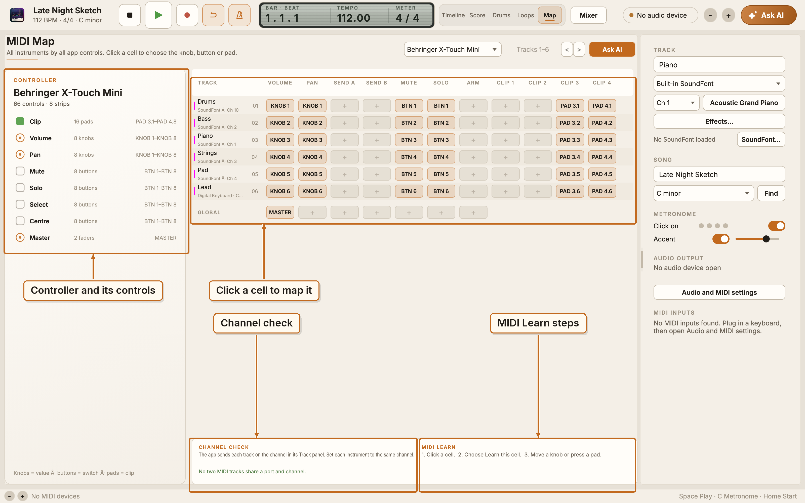

1. Choose the controller page at the top.
2. Click a cell under a control and a track.
3. Choose the control from the menu. Choose `Clear this cell` to remove it.
4. To correct an AI mapping, change only that cell. Your other cells stay.

`Ask AI` opens the AI panel with a mapping request. The assistant can read the
current controller page and write a new page. The map updates when it saves.

A map is saved as a controller page in the `Devices` folder. It replaces the
built-in page with the same `id`. Open `Options > Show Device Profiles Folder`
to find it.

### Check the instrument channel

Each track sends on the channel in its Track panel. Set the synth or keyboard
to receive on that channel. The bottom of the Map view shows the channel under
each track and warns when two MIDI tracks share a port and channel. Ask AI also
checks the channels and tells you which instrument to change. The app does not
change a synth's receive channel for you.

### MIDI Learn

Use this when a knob or pad sends a message that is not in the controller page,
or when you do not know which message it sends.

1. Click the cell that should receive the control.
2. Choose `Learn this cell...`.
3. Move the knob or press the pad. The app shows the channel and message it
   heard.
4. The cell is mapped and the controller page is saved. The map shows the new
   control.

Choose `Stop MIDI Learn` in the same menu to cancel. The AI panel can also
propose MIDI Learn when its mapping needs a message that it cannot find.

## Styles

A style is an accompaniment for an arranger keyboard, for example the Yamaha
PSR-S970 or a Korg Pa. Korg styles saved as Yamaha SFF1 or SFF2 files load in
the same way. A style has sections (`Intro A`, `Main A`, `Fill In AA`, `Ending A`)
and eight parts (two rhythm parts, bass, two chord parts, pad and two phrase
parts). The parts follow the chord that you play.

In the app, a style is a Clip grid. Each scene is a section. Each track is a
part. Thus you edit a style with the Clip grid, the note editor and the Beat
view.

If `ArrangerMidiDaw-Demo-Styles.zip` is in the same folder as the app when
you start it for the first time, the app offers to unpack 540 demo styles to
`Music/Arranger MIDI DAW/Styles` and sets the style folder. Choose
`Style > Choose Style Folder...` to use a different folder.

All style commands are in the `Style` menu.

### Fill tracks from a style

You can use a style as an accompaniment in your song. The app writes one
section of the style onto new tracks, for the number of bars that you set,
with your chords.

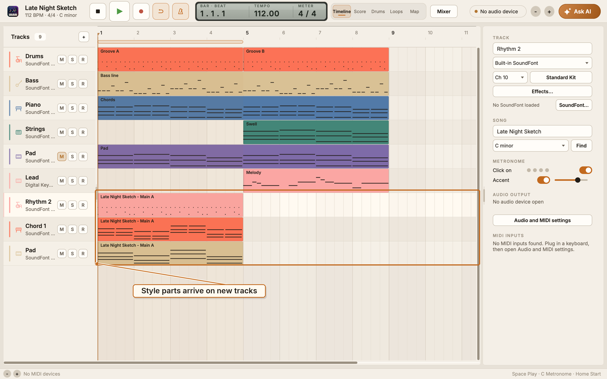

1. Put the playhead at the bar where the accompaniment must start.
2. Select `Style > Fill Tracks from a Style...`.
3. Select a Yamaha style file.
4. Select the section, for example `Main A`.
5. Type the chords, one for each bar, with a space between them. Example: `C Am F G7`.
6. Type the number of bars.
7. Click `Fill`.

The app makes one track for each part of the section, with the voice and the
mixer values of the style. Each track gets one clip with the notes.

- If there are more bars than chords, the chords start again from the first one.
- If the section is shorter than the number of bars, the section plays again.
- `-` in the chords gives a bar with no chord: only the drums play.
- You can write chords as `Cmaj7`, `Am7`, `F#m7b5`, `Bb7sus4`, `G9` or `C/E`.
- `Tempo` sets the song to the tempo of the style, or keeps the tempo of the song.

The new tracks are ordinary tracks. You can change their notes, their sounds
and their mixer values. `Edit > Undo` removes the new tracks.

### Open a style

1. Select `Style > Open Style File to Edit...`.
2. Select a Yamaha style file (`.sty` or `.prs`).

The Clip grid shows the sections and the parts. The voice and the mixer
values of each part are on its track.

### Play a style

1. Click a section name to start the section.
2. Play a chord on your keyboard below F#3. The parts follow the chord.

The `Chord` button shows the chord. The chord stays when you release the
keys. You can also click the `Chord` button and select a chord.

To change to a different section, click its name. The section starts at the
subsequent bar.

To hear the style with the voices of your keyboard, set the output of each
track to the MIDI port of the keyboard. On the keyboard, set the style to off
and set Local Control to off.

### Make a style from your clips

1. Put your clips in the Clip grid. Write all parts in the chord C major 7.
2. Select `Style > Make the Clip Grid a Style`.

The app gives each track a style part. Drum tracks become rhythm parts. The
app also gives each scene a section name that the keyboard knows.

### Make a style from a MIDI file

A section of a style uses one chord. Thus, for each section, find some bars
of the song that stay on one chord.

1. Select `File > Import MIDI File...` and open the MIDI file.
2. In the Timeline, set the loop range around the bars for one section.
3. Select `Style > Make a Style Section from the Loop Range...`.
4. Select the section name, for example `Main A`.
5. Do steps 2 to 4 again for each section.

The app copies the notes to the Clip grid. The app finds the chord of the
bars and sets it as the `Written in` chord of each part. You do not have to
change the notes to C major 7.

If the style plays incorrect notes, do a check of the `Written in` chord in
the chord rules.

### Make a style from a recording (Style from Audio)

The app can make a PSR-S970 style from an audio song. It copies the notes
and the rhythm of the parts. It does not copy the sound: you select the
voices on the keyboard.

1. Select `File > Import Audio...` and open the song.
2. Select `Style > Style from Audio...`. The AI panel shows the tool.
3. In `Recording`, select the audio clip.
4. Optional: type the tempo in `Tempo`. If you do not, the app finds the
   tempo from the drums.
5. Click `Make Style`.

To use a song from YouTube (or another site), click `From Link...` in
step 5 and paste the link. The app gets the audio with yt-dlp and puts it
on a new audio track. Then it makes the style as usual.

Note: yt-dlp and ffmpeg are free programs that you must install first.
If they are not there, the panel shows how to install them:

- macOS: `brew install yt-dlp ffmpeg`
- Windows: `winget install yt-dlp.yt-dlp Gyan.FFmpeg`
- Linux: `sudo apt install ffmpeg pipx && pipx install yt-dlp`

Caution: Use this for personal use only. Respect the terms of the site and
the rights of the music.

If the clip does not have an analysis, the app does `Analyse Audio` first
(stems, notes, chords). This can take some minutes.

The app then does these steps:

1. It finds the bar lines, the sections (Intro, Main A to D, Fill In,
   Ending) and the chords of the song.
2. It makes a pattern for each part from the bars of each section, and
   moves the notes to C major 7.
3. It plays the style with the chords of the song and compares it with
   the stems: drum hits, timing, bass notes, chord notes, and notes per bar.
4. It changes one setting of a part at a time (the bars it uses, the
   pattern length, the notes that most phrases play, quantise, clean-up).
   It keeps a change only if the match is better. It stops when no change
   makes the match better.

The panel shows the match (0 to 100%) of each section and part, and the
changes that the app kept.

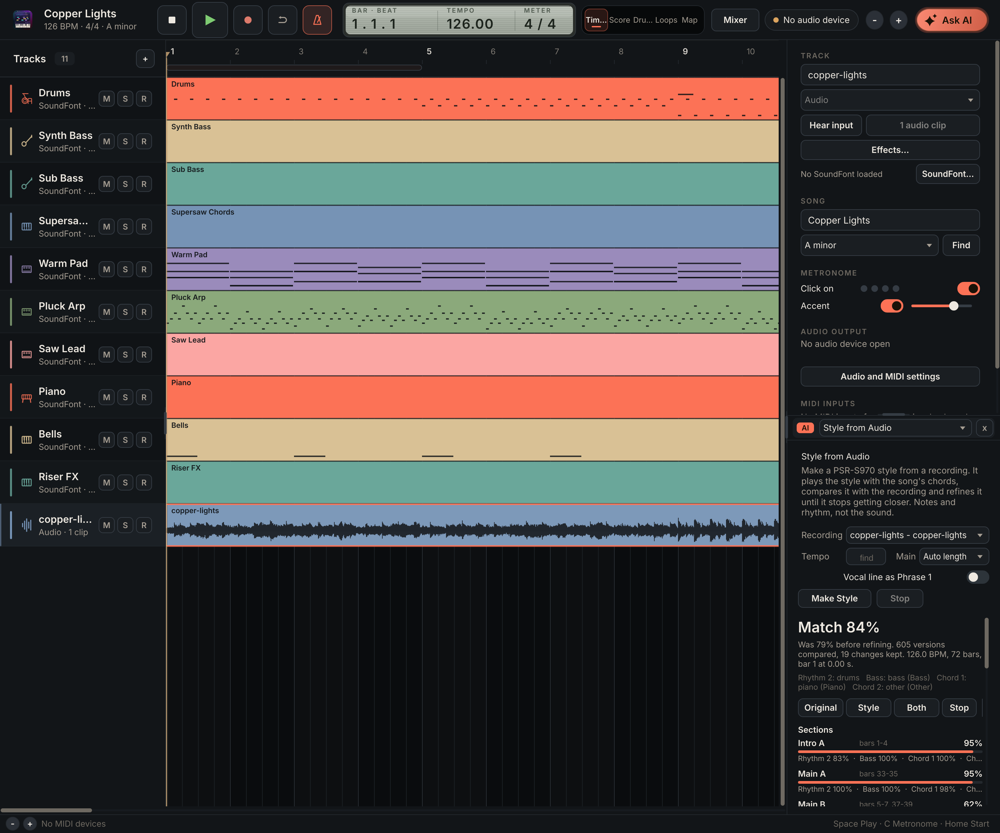

To compare the style with the recording, select a section and click
`Original`, `Style` or `Both`. Click `Stop` to stop.

To save the style, click `Save Style...`. To edit the style, click
`Open in Loops` after you save it.

Note: Drums give the best result. Pads and chords from a full mix are not
clean. Do a check of these parts in the Clip grid.

### Change the chord rules of a part

The chord rules tell a part how to follow the chord. Each part has its own
rules.

1. Right-click a slot of the part.
2. Select `Chord rules...`.
3. In `Change`, select `All sections` or only the section of the slot.
4. Change the settings. The style uses each change immediately.

| Setting | What it does |
| --- | --- |
| `Written in` | The chord that you wrote the notes in. |
| `Chord root` | The notes move with the root, or they stay near the written pitch. |
| `Chord type` | `Chord` is for chord parts. `Melody` is for bass and phrases. `As written` is for drums. |
| `Follow the bass note` | The part plays E for the chord C/E. Use it for the bass part. |
| `Highest root` | Chord roots above this note play one octave lower. |
| `Note limits` | Notes outside the limits move by octaves. |
| `Held notes` | What a held note does on the keyboard when the chord changes. |

To undo a change, select `Edit > Undo`.

### Save a style

Select `Style > Save as Style File...`. Copy the `.sty` file to a USB memory
and load it on the keyboard.

The chord rules in the app follow the rules that Yamaha publishes. The
keyboard can play some notes differently. Always do a check of a new style on
the keyboard.

## Score view

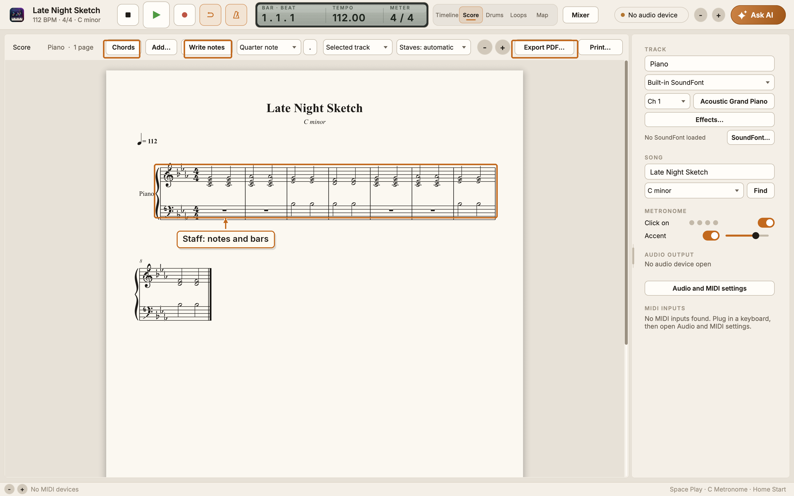

The Score view shows your tracks as printed music. You can read the
score, change it and print it.

1. Click the `Score` tab.
2. Select the tracks to show in the tracks box above the page.

| Selection | Result |
| --- | --- |
| `All tracks` | A full score: all tracks, one below the other. The name of each track is at the left of its staff. |
| `Selected track` | Only the track that is selected in the track list. |
| `Choose tracks...` | A menu of the tracks. Click a track to add it to the score or to remove it. |

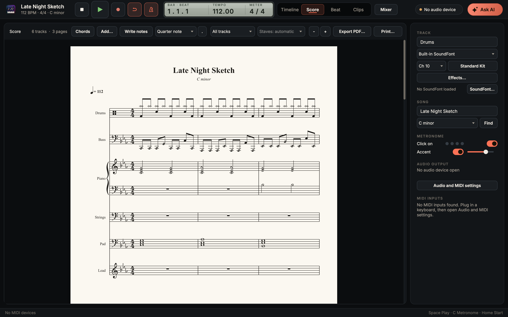

Audio tracks do not show in the score.

In a full score, click a note or a staff to select its track. New notes,
chord symbols, lyrics and dynamics go to the selected track. The `Staves` box
is available only when the score shows one track.

The PDF and the printed score show the same tracks as the screen.

The score shows the notes that the track plays on the Timeline. Loops play
again in the score, as on the Timeline. While the song plays, a copper cursor
moves across the score, and the page scrolls to keep the cursor in view.

### How the app writes the notes

Played notes are not exact. The app moves each note to the nearest 16th note
or eighth-note triplet in the score. The notes in your song do not change.

- The app uses the key and the meter of the song. Set them in the inspector.
  To let the app find the key from the notes, click `Find` next to the key.
- The app spells each note in the key. In a minor key, the raised 6th and 7th
  notes get sharps or naturals (in D minor: `C#`, not `Db`).
- A note that is not in the key and moves a half step gets the spelling of its
  direction. Up: `C C# D`. Down: `D Db C`.
- The app selects the clef from the notes and the track name. A track with
  "Piano", "Keys", "Organ", "Harp", "Rhodes" or "Clav" in its name gets a
  grand staff. A track with a very wide range also gets a grand staff.
- A drum track (MIDI channel 10, or a `Drum sampler` track) gets a drum staff.
  Cymbals and hi-hats have X noteheads.

To change the staves, use the box above the score:

| Setting | Result |
| --- | --- |
| `Staves: automatic` | The app selects one staff or a grand staff. |
| `One staff` | All notes go on one staff. |
| `Grand staff` | Notes from middle C up go on the treble staff. Lower notes go on the bass staff. |

Click `-` or `+` to make the pages smaller or bigger.

### Change notes in the score

Click a notehead to select the note. The selected note becomes orange.
Hold `Shift` and click to select more notes. Push `Cmd+A` to select all notes.

| To do this | Do this |
| --- | --- |
| Move a note up or down in the key | Drag the notehead, or push the `Up` or `Down` arrow |
| Move by a semitone | `Alt` + `Up` or `Down` arrow |
| Move by an octave | `Shift` + `Up` or `Down` arrow |
| Move earlier or later by a 16th note | `Left` or `Right` arrow |
| Make longer or shorter by a 16th note | `Shift` + `Right` or `Left` arrow |
| Delete | `Delete` |
| Cut, copy or paste | `Cmd+X`, `Cmd+C` or `Cmd+V`. You can also right-click. |
| Remove the selection | `Esc` |

The changes go to the clips on the Timeline. `Cmd+Z` undoes a change.

A tied note is one note. If you change one part of it, the full note changes.

### Write notes

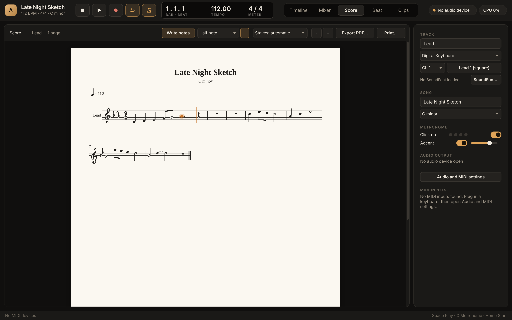

1. Click `Write notes`, or push `N`. An orange line shows where the next note
   goes.
2. Select the note length in the box, or push a key:

   | Key | Length |
   | --- | --- |
   | `7` | Whole note |
   | `6` | Half note |
   | `5` | Quarter note |
   | `4` | Eighth note |
   | `3` | 16th note |
   | `2` | 32nd note |
   | `.` | Dotted note on or off |

3. Write the notes. There are three procedures:
   - **Mouse:** click on the staff at the time and the pitch that you want.
   - **Computer keyboard:** push a letter from `A` to `G`. The app uses the
     sharps and flats of the key. The note goes in the octave nearest to the
     last note. Then use the arrows to change it.
   - **MIDI keyboard:** play a key. To write a chord, hold the first key and
     play the other keys.
4. Push `0` to write a rest.
5. Push `N` or `Esc` to stop.

After each note, the orange line moves to the end of that note. If there is no
clip at that position, the app makes a clip of one bar.

### Add chord symbols, lyrics and marks

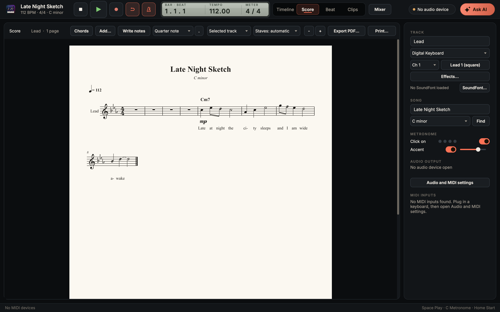

1. Select a note. The mark goes at this note.
2. Click `Add...` and select the type of mark.

| Mark | Procedure |
| --- | --- |
| Chord symbol | Select `Chord symbol...`, or push `K`. Write the chord, for example `Cm7` or `Bb/D`. |
| Lyrics | Select `Lyrics...`, or push `L`. Write the words. Each word goes under one note, from the selected note on. |
| Dynamic | Select `Dynamic`, then `pp`, `p`, `mp`, `mf`, `f` or `ff`. |
| Articulation | Select `Articulation`, then `Staccato`, `Accent`, `Tenuto`, `Marcato` or `Fermata`. |

- To divide a word between two notes, put a hyphen in it: `Twin-kle`.
- If you select more than one note, an articulation goes on each note.
- To remove an articulation, select the same articulation again.
- To remove a chord symbol, open `Chord symbol...` and delete the text.
- To remove all marks at a note, select `Remove all marks at the selected notes`.

The marks show in the score, in the PDF and in MusicXML files. They do not
change the sound. A mark stays at its time in the song. If you move a note,
the mark does not move with it.

### Chords and guitar chords

The app can find the chords in your notes and write the chord symbols above
the score. It can also show a guitar chord box above each chord symbol.

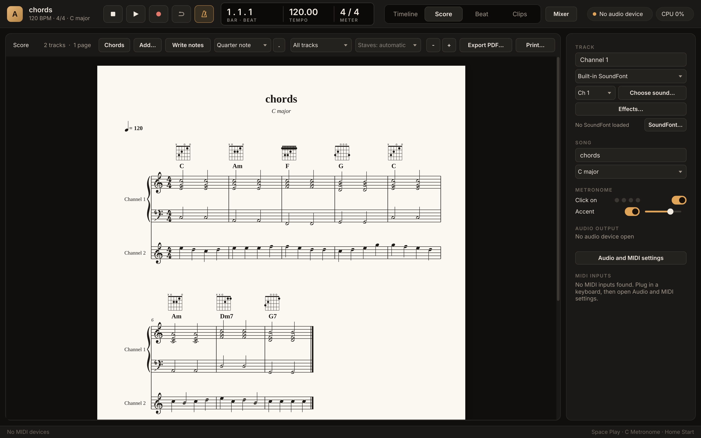

To find the chords:

1. Click `Chords`.
2. Select `Find Chords in the Notes`.
3. Select how often the chord can change: `One chord a bar`, `Up to two chords a bar` or `Up to one chord a beat`.

The app looks at the notes of all tracks in the score. It does not look at
drum tracks. The chord symbols go above the top track of the score.

- If you select notes first, the app finds the chords only in the bars of these notes.
- The new chords replace the chord symbols that were there before.
- A track that plays one note at a time (a melody) does not change the chord when a different track plays chords.
- If the lowest note is not the root of the chord, the chord gets a bass note, for example `C/E`.
- The app spells the chord in the key of the song. In Db major the chord is `Gb`, not `F#`.

To show the guitar chords, click `Chords` and select `Show Guitar Chords`.
Select it again to hide them. The guitar chords also show in the PDF. The
project file keeps this setting.

How to read a guitar chord box:

- The vertical lines are the strings. The low E string is at the left.
- The horizontal lines are the frets. A thick line at the top is the nut.
- A dot is a finger on the string. A thick bar is a barre: one finger on many strings.
- `o` above a string: play the open string. `x` above a string: do not play the string.
- A number such as `5fr` at the right: the top fret of the box is fret 5.

If two chords are very near to each other, the app shows the chord symbol
but not the second guitar chord box.

To remove the chords, click `Chords` and select `Remove All Chords`. If notes
are selected, the app removes only the chords in their bars.

### Print the score or save it as a PDF

- To save the score as a file, click `Export PDF...`. Select a name and a
  folder.
- To print, click `Print...`. The app opens the score as a PDF in your PDF
  viewer. Print it from there.

The PDF has A4 pages. It shows the same score as the screen.

## Note editor

Double-click a clip to open the note editor. Push `Esc` or click `Close` to
close it.

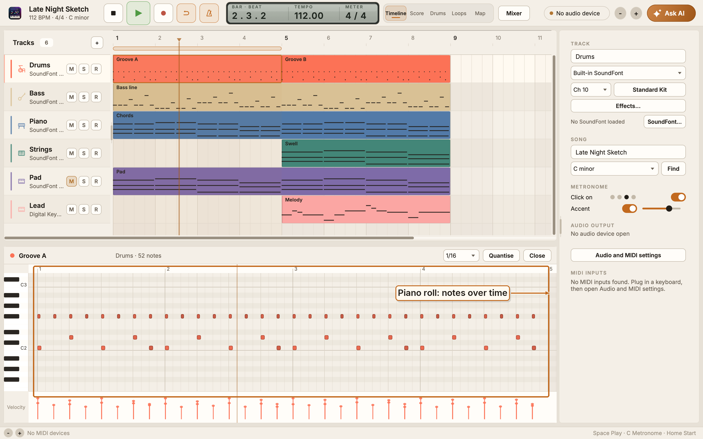

| To do this | Do this |
| --- | --- |
| Add a note | Click an empty area |
| Select notes | Click a note, or drag on an empty area |
| Move a note | Drag it left, right, up or down |
| Change the length | Drag the right edge of the note |
| Delete a note | Double-click it, or select it and push `Delete` |
| Move by a semitone | `Up` or `Down` arrow |
| Move by an octave | `Shift` + `Up` or `Down` arrow |
| Change the velocity | Drag in the velocity lane at the bottom |
| Select all notes | `Cmd+A` |
| Cut, copy or paste | `Cmd+X`, `Cmd+C` or `Cmd+V`. You can also right-click. |
| Quantise | `Q`, or click `Quantise` |
| Hear a pitch | Click a key of the piano at the left |

The grid box sets the step for new notes, for movement and for quantise.
Hold `Alt` to ignore the grid.

`Quantise` moves the selected notes to the grid. If no notes are selected, it
moves all notes in the clip.

## Mixer

The mixer is a panel at the bottom of the window. It stays there in the
Timeline, Score, Beat and Clips views.

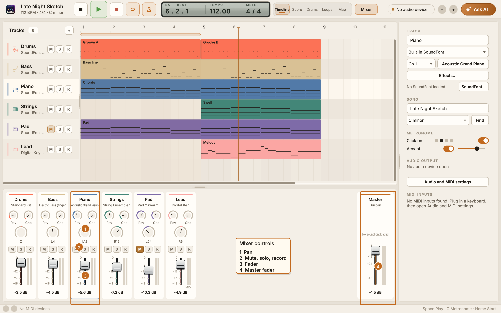

- To show or hide the mixer, click the `Mixer` button in the top bar, or push `Cmd+2`.
- To change the height of the mixer, drag the small bar above it up or down.
- To set the default height again, double-click the bar.

The app keeps the height for the next time.

A tall mixer shows all controls. When you make the mixer smaller, the strips
hide the sound name and the `Rev` and `Cho` knobs first, then the `Pan` knob.
The track name, the `M`, `S` and `R` buttons, the fader and the meter always
show.

Each track has a strip:

- **Sound:** the program name under the track name, such as `Acoustic Grand Piano` or `Standard Kit`.
- **Rev** and **Cho** knobs: reverb and chorus level.
- **Pan** knob: left or right position.
- **M**, **S**, **R**: mute, solo, record arm.

Only one track can be solo at a time. When you click **S** on a track, the
solo goes off on the other tracks. To solo more tracks, hold `Shift` or `Cmd`
and click **S**.
- **Fader:** volume.
- **Meter:** the level of tracks that use the built-in SoundFont.

When the AI assistant or a MIDI controller moves a fader, it glides to the new
value for a moment, so you can see the change.

Drag a knob up or down to change it. Hold `Shift` for small steps.
Double-click a control to set it to its default value.

The `Master` strip sets the level of the built-in SoundFont player.

For MIDI ports, the strip sends MIDI controllers to your synth: volume (CC 7),
pan (CC 10), reverb (CC 91) and chorus (CC 93). A device profile can change
these numbers.

### Buses

A bus mixes the sound of more tracks. A bus has its own effects, pan, mute and
fader. Its sound goes to the master. Use a bus in two ways:

- **Group:** send the full sound of more tracks to the bus. For example, put the drums and the bass on one fader.
- **Return:** send a part of the sound of more tracks to the bus, and put an effect on the bus. For example, one reverb plugin for all tracks.

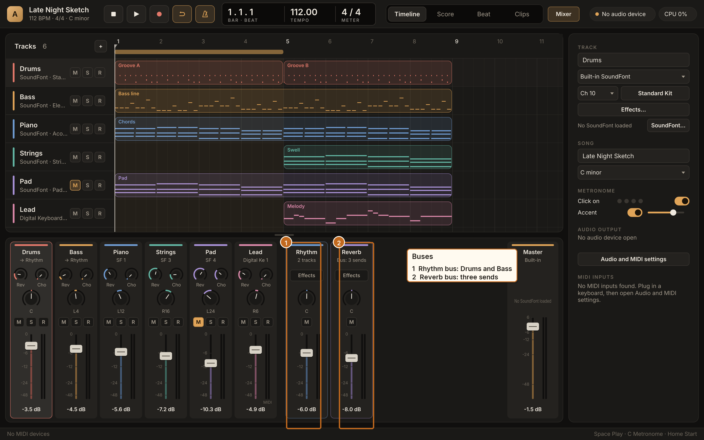

To add a bus, select `Track > Add Bus`. You can also right-click the mixer and select `Add Bus`.
The bus strips show at the right of the track strips.

| To do this | Do this |
| --- | --- |
| Send a track to a bus | Right-click the strip of the track, select `Output` and select the bus |
| Send a track to the master again | Right-click the strip of the track and select `Output > Master` |
| Send a part of a track to a bus | Right-click the strip of the track, select `Sends...` and move the slider of the bus |
| Add effects to a bus | Click `Effects` on the bus strip |
| Rename a bus | Double-click the name of the bus |
| Remove a bus | Right-click the bus strip and select `Remove Bus` |

Know these rules:

- A send comes after the fader of the track. If you make the track quieter, the send also gets quieter.
- A send level of 100 sends the sound at the level of the track. Set the level to 0 to remove the send.
- Only tracks whose sound the app makes can use a bus: SoundFont, `Drum sampler`, plugin and audio tracks. The sound of a MIDI port track comes from your synth, not from the app.
- The bus strip shows how many tracks go to the bus and how many tracks send to it.
- When you remove a bus, its tracks go to the master again.
- The `Rev` and `Cho` knobs of a SoundFont or MIDI port track are not sends to a bus. They set the reverb and chorus of the SoundFont player or of your synth.

## Automation

Automation changes the volume, the pan, the reverb send or the chorus send of a track while the song plays. You draw a line on the Timeline, and the track follows the line.
Use it for a fade in, a fade out, a part that must be quieter in one section, or more reverb in the chorus of a song.

### Show the line of a track

1. Right-click the track in the track list.
2. Select `Automation`.
3. Select `Show Volume Line`, `Show Pan Line`, `Show Reverb Send Line` or `Show Chorus Send Line`.

Audio tracks have no reverb send and no chorus send. For these tracks, the menu shows only the volume line and the pan line.

The line shows on top of the clips of the track. While the line shows, the mouse works on the line and not on the clips.
To work on the clips again, select `Automation > Hide`. The automation stays active when the line is hidden.

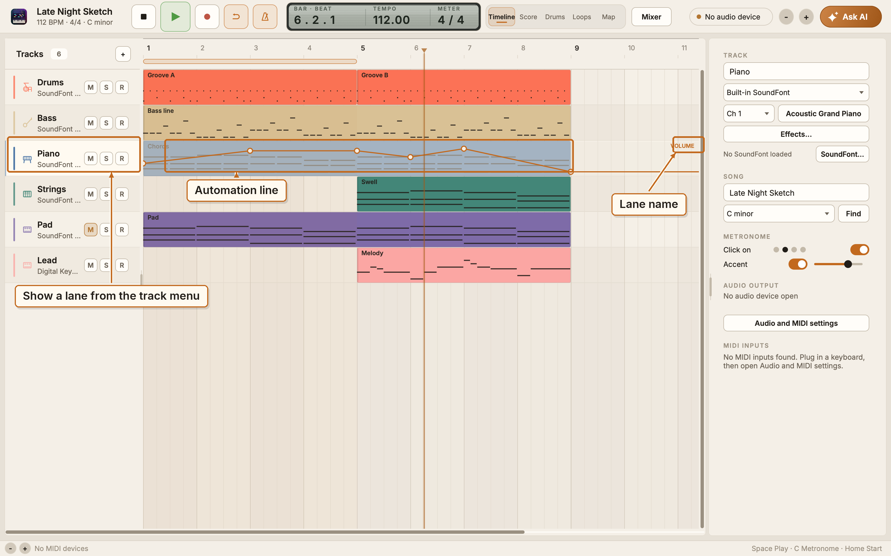

### Draw the line

| To do this | Do this |
| --- | --- |
| Add a point | Click on the track |
| Move a point | Drag it |
| Select points | Click a point. Hold `Shift` and click to select more points. Push `Cmd+A` to select all points of the line. |
| Remove points | Select them and push `Delete`. You can also right-click a point and select `Delete`. |
| Cut, copy or paste points | `Cmd+X`, `Cmd+C` or `Cmd+V`. You can also right-click the line. |
| Remove all points | Right-click the track in the track list and select `Automation` and then the `Remove` command for the line |

The value moves in a straight line from one point to the next. Before the first point and after the last point, the value stays the same.

Points snap to bars or beats. Hold `Alt` to put a point at any position.

For volume, the top of the track is the maximum (127) and the bottom is silence. A value of 100 is the usual level.
For pan, the top is right, the bottom is left and the middle is the centre.
For the reverb send and the chorus send, the top is the maximum (127) and the bottom is no effect.

When a track has volume points, the line sets the volume and the volume fader of the Mixer has no effect. The same applies to the pan, the reverb send and the chorus send.

Automation works on all tracks. A track with a MIDI port output sends the values to your synth as volume, pan, reverb and chorus messages.

### Automate a control of a plugin

You can draw a line for each control of a plugin on a track. Use it for a filter that opens slowly, or a delay that gets louder at the end of a phrase.

1. Right-click the track in the track list.
2. Select `Automation > Plugin Control`.
3. Select the plugin.
4. Select the control. If the plugin has more than 40 controls, the menu shows them in groups.

The line of the control shows on the track. Draw the line as you draw a volume line.
The top of the track is the maximum of the control and the bottom is the minimum. While you drag a point, the label shows the value in percent.

The line then has its own commands in the `Automation` menu: `Show ... Line` and `Remove ... Automation`.

Know these rules:

- The line moves the control only while the song plays. When the song stops, the control stays at its last value.
- While the song plays, you cannot move an automated control in the plugin window. The line moves it back.
- A line with no points does nothing.
- The line stays with its plugin. If you move the effect up or down, the line moves with it. If you remove the plugin, you remove its lines.
- The menu shows only plugins that are loaded.
- The effects on the master have no automation lines.

## Talk to the app (AI assistants)

You can tell an AI assistant what to change, in your own words. For example:
"Add a bass track that plays the root of each chord in bars 1 to 8", "Make
the drums quieter in the chorus" or "Write the lyrics under the melody".
The assistant reads the song and changes it. You see each change in the app
at once.

The app uses the Model Context Protocol (MCP). Claude Desktop, Claude Code and
Codex can use it. Other assistants that use MCP can use it too.

### Set up Claude Desktop

1. In the app, select `Options > Allow AI Assistants`. A tick shows next to the command.
2. Select `Options > Copy AI Assistant Setup`. The app copies the settings and shows them.
3. In Claude Desktop, open `Settings > Developer` and click `Edit Config`.
4. Paste the settings into the file `claude_desktop_config.json`. If the file already has a `mcpServers` part, add only the `arranger-midi-daw` lines to it.
5. Save the file.
6. Close Claude Desktop and open it again.

To use Claude Code, run the command that `Copy AI Assistant Setup` shows:
`claude mcp add arranger-midi-daw` and the path of the helper program.

To use Codex, run the command that `Copy AI Assistant Setup` shows:
`codex mcp add arranger-midi-daw --` and the path of the helper program.

### The helper program

MCP clients start `arranger-mcp` themselves, so the app ships it as a separate
small program next to the app:

- macOS: `Arranger MIDI DAW.app/Contents/MacOS/arranger-mcp`
- Windows: `arranger-mcp.exe` in the same folder as `Arranger MIDI DAW.exe`
- Linux: `arranger-mcp` in the same folder as `Arranger MIDI DAW`

Keep it next to the app. If it is missing, the app shows an error when you
select `Options > Copy AI Assistant Setup`. The helper connects to the running
app over a socket on this computer; it does not use the internet.

### Use it

1. Open the app and your song.
2. In the assistant, write what you want to change.

Keep the app open while you work. If the app is closed, or `Allow AI
Assistants` is off, the assistant tells you so.

Each change of the assistant is one undo step. Its name starts with `AI:`,
for example `Undo AI: Add Notes`. Push `Cmd+Z` to undo it.

### Chat in the app

You can also talk to an assistant in the app. Click the copper `Ask AI` button
at the right of the header, or push `Cmd+J`. The chat window opens. Click the
button again to close it. `Options > AI Chat` does the same.

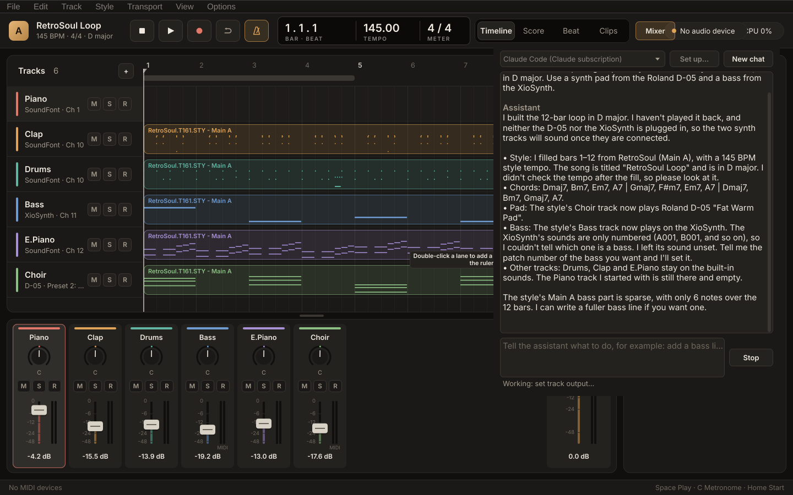

Choose an assistant at the top of the window:

| Assistant | What you need |
| --- | --- |
| Claude Code (Claude subscription) | The Claude Code program, signed in with your Claude account. |
| Codex (ChatGPT subscription) | The Codex program, signed in with your ChatGPT account. |
| Gemini CLI (Google account) | The Gemini CLI program, signed in with your Google account. |
| Claude with an Anthropic API key | A key from console.anthropic.com. You pay for each use. |
| DeepSeek with an API key | A key from platform.deepseek.com. You pay for each use. |
| Other AI with an API key | A service with an OpenAI-style chat API, for example OpenAI, Gemini or Ollama. |

The first three use your subscription, not an API key. The app starts the
program on your computer for each message. The program uses its own sign-in.

The Codex choice pre-approves the app's song tools, because the app has no
approval dialog. Codex still cannot write files or run shell commands.

To set up a program:

1. Install the program. Click `Set up...` to see how.
2. Open a terminal and start the program once. Sign in with your account.
3. In the chat window, choose the program.

If the app cannot find the program, click `Set up...` and type the full path
of the program.

To use an API key:

1. Choose `Claude with an Anthropic API key`, `DeepSeek with an API key` or `Other AI with an API key`.
2. Click `Set up...`.
3. Type the key. For `Other AI with an API key`, also type the address and the model.
4. Click `Save`.

Then type what you want and push `Return`. The assistant tells you what it
changed. Click `Stop` to stop it. Click `New chat` to start a new conversation.

The chat turns on `Options > Allow AI Assistants` when it uses a program.
The app keeps an API key in its settings file on your computer.

To add a different program, write it in the file `assistants.json` in the
app's settings folder (next to `mcp-connection.json`). Give each program a
`name`, a `command` and its `args`. The app sends your message to the
program's input and shows what the program writes.

### What the assistant can do

| Part | The assistant can |
| --- | --- |
| Song | Read the song. Change the title, the tempo, the time signature and the key. |
| Tracks | Add, change and delete tracks. Choose General MIDI sounds. Change the volume, pan, reverb, chorus, mute and solo. |
| Notes and clips | Read notes. Write, delete, transpose and quantise notes. Change the velocity and the length. Move, copy, split and delete clips. |
| Score | Find chords. Write chord symbols, dynamics, articulations and lyrics. |
| Music theory | Find the key and the key changes. Name the chords with roman numerals (`I`, `V7/V`, `bVII`). Give the notes and chords of a scale or mode. Change roman numerals to chords (`ii7 V7 I` in Eb major is `Fm7 Bb7 Eb`). Find voice-leading errors, for example parallel fifths. |
| Skills | Find built-in and user skills by words or tags. Read a skill's instructions, examples and data. Use the built-in common chord progressions and add more JSON packs later. |
| Beat | Read and write drum patterns, step by step. |
| Clip grid | Read the grid. Fill, clear and name slots and scenes. Start scenes and slots. |
| Styles | Find a style by name in your style folder. Read its sections. Fill tracks from a section, with your chords, for a number of bars. |
| Synths | List the synths that are connected. Find a sound by name in a synth's sound list. Send a track to a synth and choose its sound. Change the sound settings of a synth (filter, envelopes and more). Read the sound names that are in the synth. Give names to sounds. |
| MIDI setup | List the MIDI inputs and outputs, the synths and the controller layouts. Turn MIDI inputs on and off. Choose the MIDI input and channel of a track. Tell the app which synth or controller is on a port. Read the MIDI that came in during the last seconds. Map knobs and buttons. Read, write and fix device profiles. |
| Transport | Play, stop and go to a bar. Undo and redo. |

The assistant uses bars and beats as the app does: bar 1, beat 1 is the start
of the song.

### Styles and synths

To let the assistant use your styles, select `Style > Choose Style Folder...`
and choose the folder with your style files. The assistant also looks in the
subfolders. The name does not have to be exact: "Beat16" also finds
"16 Beat Ballad".

The assistant finds a synth sound by the name in the synth's device profile.
Some profiles have numbers in place of names (for example the XioSynth: `A001`
to `B128`). For these, tell the assistant the number of the sound.

For example: "Make a 12 bar loop in D major from the style RetroSoul. Use a
pad from the D-05 and the bass on the XioSynth, sound B012."

### Music theory

The assistant can analyse your song and use music theory. Examples:

- "What key is this song in? Set it."
- "Show the chords of bars 1 to 16 with roman numerals."
- "Write a ii-V-I in the song key on the Piano track, one chord a bar."
- "Write a melody in D dorian for bars 9 to 16."
- "Check the voice leading of the Choir track."

The voice-leading check uses the rules for classical part writing. Parallel
fifths and octaves are normal in pop and dance music, so use the check when
you want a classical sound.

### Common chord progressions

The built-in **Common chord progressions** skill holds the common progressions.
The assistant searches the skill layer by words or tags, reads the skill, then
writes the result in any key. The list follows the common progressions in
[Musicca's chord player](https://www.musicca.com/chord-player).

| Genre | Examples |
| --- | --- |
| Pop | `I–V–vi–IV`, `I–IV–V–I`, `I–vi–ii–V`, `i–iv–V–i` |
| Rock | `I–vi–IV–V`, `I–IV–I–V`, `I–III–IV–iv`, `vi–V7/vi–II–V7` |
| Jazz | `ii7–V7–Imaj7–Imaj7`, `Imaj7–vi7–ii7–V7`, `viø7–ii7–V7–Imaj7`, `i7–V7–i7–V7` |
| Blues | The twelve-bar `I7–IV7–V7` progression |

Ask for a progression in your song's key. Examples:

- "Use a pop I–V–vi–IV progression in D major on the Piano track."
- "Find a jazz ii–V–I and write it on bars 1 to 4."
- "Give me a twelve-bar blues in C, one chord a bar."
- "What common rock progressions can I use?"

The assistant writes chord symbols with `set_chords`. To hear the progression,
ask it to add the chord notes, or use a style with `fill_from_style`.

### Skills

Skills are the assistant's recipes and data, separate from its code tools.
The built-in skills are always available. To add your own, put JSON files in the
`Skills` folder in the app's settings folder:

- macOS: `~/Library/Application Support/Arranger MIDI DAW/Skills`
- Windows: `%APPDATA%\Arranger MIDI DAW\Skills`
- Linux: `~/.config/Arranger MIDI DAW/Skills`

A skill has an `id`, a `name`, a `description`, a `when`, and `instructions`.
`tags`, `examples` and `data` are optional. A file may hold one skill, a list,
or an object with a `skills` list. A small skill:

```json
{
  "skills": [
    {
      "id": "my-progression",
      "name": "My progression",
      "description": "A progression I use.",
      "when": "When I ask for my progression.",
      "instructions": "Write these chords with set_chords.",
      "tags": ["chords", "progressions"],
      "data": { "roman": "I vi IV V" }
    }
  ]
}
```

The assistant finds skills with `find_skills` and reads one with `get_skill`.
Skills contain text and data only; they never run code. Bad files are skipped,
and the assistant can report what was skipped when asked.

### MIDI setup

The assistant can help you set up your MIDI devices. For example:

- "Which MIDI devices are connected?"
- "Use the Launchkey as my keyboard, record from the PSR on channel 1, put the X-Touch knobs on the mixer."
- "Record the piano track from the Launchkey only."
- "Turn off the MIDI input of the D-05."
- "My X-Touch Mini is on the USB MIDI cable. Use its mixer layout there."
- "Use the Launchkey as a plain keyboard, not as a mixer controller."
- "I turn the first knob on the X-Touch Mini now. What does it send?"
- "Make a device profile for my new synth from this MIDI chart."
- "Give the XioSynth sounds names: B012 is Analog Bass."
- "Read the sound names from the D-05."
- "Make the XioSynth sound brighter, with a slow attack."

To find out what a knob, a key or a pedal sends, use it first. Then ask the
assistant. The app keeps the MIDI of the last two minutes.

To map a knob or a button (MIDI Learn), move it and tell the assistant what it
must do. For example: "I turned a knob on the XioSynth. Make it the volume of
track 1." The assistant adds the knob to the controller layout of the device.

The app finds the synth or the controller on a port from the name of the port.
If the name does not tell the app (for example a USB MIDI cable), tell the
assistant which device is on the port. The app keeps this choice.

The assistant writes new device profiles to the `Devices` folder in the app's
settings folder. A profile there replaces a built-in profile with the same
name. The built-in profiles do not change. Before the app saves a profile, it checks the profile.
If the profile has an error, the app does not save it and the assistant gets
the error.

### Safety

- The connection works only on your computer. Other computers cannot connect to it.
- The app makes a new secret key each time it starts. Only programs that can read your files can use it.
- To stop all AI access, select `Options > Allow AI Assistants` again. The tick goes away.

## Plugins

A plugin is a piece of software from a different maker that makes or changes sound in the app.
The app uses VST3 plugins. On a Mac, it also uses Audio Unit plugins.

- An instrument plugin plays the notes of a track.
- An effect plugin changes the sound of a track or of the full mix. Reverb and compression are examples.

### Find your plugins

1. Select `Options > Scan for Plugins...`.
2. Wait until the scan is complete. The first scan can take some minutes.

The app examines each plugin in a separate program. If a plugin fails, the app stays open and skips that plugin from then on.

Do the scan again after you install a new plugin.

### Play a track with an instrument plugin

1. Select the track.
2. In the output list, select `Plugin instrument`.
3. Click `Choose instrument...`.
4. Select the plugin.

The window of the plugin opens. To open the window again later, click the name of the plugin.

Volume, pan, mute and solo in the Mixer work for the track.

### Add effects to a track

1. Select the track.
2. Click `Effects...`.
3. Click `Add Effect...` and select the plugin.

The sound goes through the effects from the top of the list to the bottom.

| To do this | Do this |
| --- | --- |
| Open the window of an effect | Click its name |
| Turn an effect off and on | Click the dot at the left of its name |
| Change the order | Click the arrows |
| Remove an effect | Click `×` |
| Change the instrument | Right-click the name of the instrument |

Effects work on all tracks that make their sound in the app.
A track with a MIDI port output makes its sound in your synth, so effects do not apply to it.

On a `Built-in SoundFont` track, the effects change the sound of the MIDI channel of the track.
Give each SoundFont track its own channel. The reverb and chorus of the SoundFont player do not go through the effects.

Some plugins give their sound a short time late. The app holds the other tracks back by the same time, so all tracks stay together.

### Add effects to the full mix

Select `Options > Master Effects...`. Then add effects as you do for a track.

### Plugins and project files

The project file contains the settings of each plugin. The app reads the settings when you save the project and when you close a plugin window.

If you open a project on a computer that does not have one of its plugins, the name of the plugin shows `(not loaded)`.
The slot stays silent. The project keeps the settings of the plugin, and the plugin works again after you install it and do a scan.

## Hardware controllers

The app has mixer pages for these controllers. The Launchkey Mini MK3 pads
start clips in the first two scene rows. The X-Touch Mini Layer A buttons start
clips in the next two rows. Both controllers keep their knobs and faders on the
mixer. Connect the controller. The app turns on its MIDI inputs. No other
setup is necessary.

The app turns on the MIDI input of each keyboard, synth and controller when you
connect it, also when the app has no profile for it. Software ports (IAC,
network sessions, loopMIDI) stay off, because they can send the MIDI back to
the app. If you turn off an input in `Audio and MIDI Settings...`, the app keeps it off,
also after you connect it again. Turn it on again to cancel this.

- Novation Launchkey Mini MK3
- Behringer X-Touch Mini
- Novation XioSynth 49 (you must make a template on the synth first)

[Controller mixer pages](controllers.md) shows the function of each knob and
button.

## Your synths

The app has device profiles for the Yamaha PSR-S970, the Roland D-05, the
Novation XioSynth and Korg Pa arrangers. It also has profiles for Roland GS
and Yamaha XG devices.
The app selects the profile from the name of the MIDI port.

To add a synth, write a device profile. [Device profiles](device-profiles.md)
tells you how. You can also ask the AI assistant to write it from the synth's
MIDI chart (see "MIDI setup").

To set a synth to its default MIDI state, click the sound button and select
`Reset`. This item shows only if the profile has a reset message.

### Change the sound of a synth

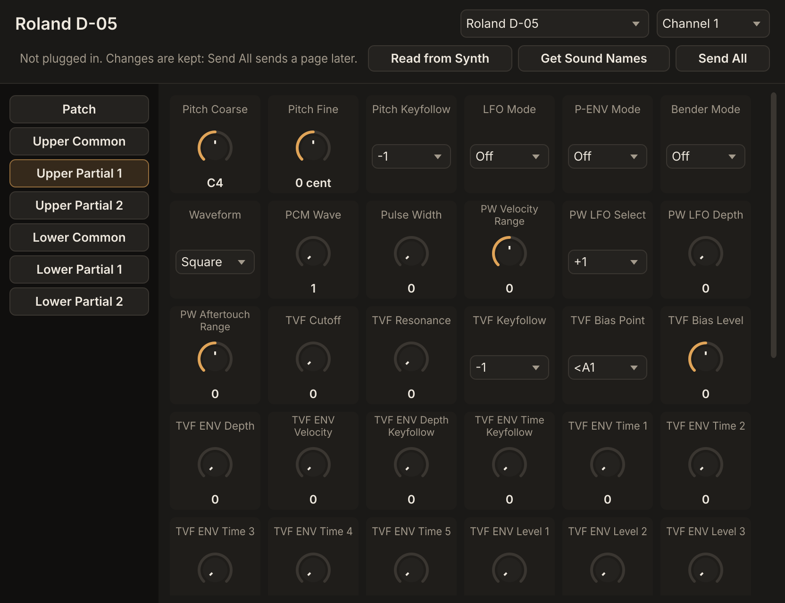

The sound editor shows the settings of a hardware synth as knobs and lists.
The app has sound editors for the Roland D-05 and the Novation XioSynth.

1. Select a track that plays on the synth.
2. Select `Track > Synth Sound Editor...` (Cmd+Shift+E).
3. Make sure that the channel is the MIDI channel of the synth.
4. Click a page at the left, for example `Filter`.
5. Drag a knob up or down. Hold Shift for small steps. Double-click a knob to
   set it to its default value.

The app sends each change to the synth immediately. The synth does not save
the change. To keep the sound, save it on the synth.

When you turn a knob on the XioSynth, the knob on the screen also moves. On
the D-05, set `Exclusive` in the SYSTEM MIDI menu to `TxEdit` for the same
result.

| Button | What it does |
| --- | --- |
| `Read from Synth` | Gets the settings of the sound that plays now (D-05 only). The MIDI input of the synth must be on. |
| `Get Sound Names` | Reads the names of the sounds in the synth's memory and adds them to the sound list (D-05 only). |
| `Send All` | Sends all the settings of the page to the synth. |

### Get the sound names from the synth

When you make or load new sounds on a synth, the app does not know their names.
To add the names to the sound list:

- On the D-05: in the sound editor, click `Get Sound Names`. The app reads
  the 8 Internal banks. This takes approximately 30 seconds. During this time,
  the D-05 changes banks.
- On a synth that cannot send its sound names (for example the XioSynth): ask
  the AI assistant, for example "B012 on the XioSynth is Analog Bass". Or
  write the names in a sound list file (see [Device profiles](device-profiles.md)).

The app keeps your names in the file `<device>.sounds.yaml` in the `Devices`
folder (`Options > Show Device Profiles Folder`). The built-in sound list does
not change.

### Add a sound editor for a different synth

A sound editor is a list of settings in the device profile of the synth.
Each setting has a name, a range and the MIDI message that changes it (a
controller, an NRPN or a SysEx address). You do not have to write code.
[Device profiles](device-profiles.md) tells you how. The AI assistant can also
write the list from the synth's MIDI chart: "Add a sound editor to my synth's
device profile from this MIDI chart."

## AI music tools

The AI music tools write and change notes for you. They run on your
computer, not on the internet. Use the `AI` menu, or ask the AI chat.

The AI chat and the AI music tools open in the right side panel. Choose `Chat`
or a tool in the panel's menu. Drag the left edge of the side panel to make it
wider or narrower. The track inspector above it scrolls when the panel is
open.

| Command | What it does | Model |
| --- | --- | --- |
| `AI > Humanize...` | Makes notes sound played by a person: small changes in timing and loudness. | Magenta Groove (drums in 4/4), or Simple (any track, no install) |
| `AI > Drumify...` | Makes a drum part from the rhythm of a track, for example a bass line. | Magenta Drumify |
| `AI > Continue with AI...` | Continues a track or all tracks from the bars before. When music comes after the bars, it fills the gap. | Magenta MelodyRNN and DrumsRNN, or the Anticipatory Music Transformer |
| `AI > Write a Part...` | Writes a new part that fits the other tracks, for example "a bass under this". | Anticipatory Music Transformer |
| `AI > Melody over Chords...` | Writes a melody over the chord symbols of the song. | Magenta ImprovRNN |

### Install the AI music tools

1. Select `AI > Install AI Music Tools...`.
2. To also get "Write a Part", keep `Also the Anticipatory Music Transformer`
   on. This needs approximately 2 GB. Magenta needs approximately 100 MB.
3. Select `Install AI Music Tools`. Keep the window open until the text shows
   that the install is complete.

The install uses Node.js (for Magenta) and the app's Python (for the
Anticipatory Music Transformer). If Node.js is not on your computer, the
install gets it. After the install, the tools work without the internet.

### Speech

The AI chat has two speech buttons:

- The **microphone** starts voice input. Click it, speak, then click it again.
  The built-in Whisper writes down the words and puts them in the message box.
  Voice input needs a Whisper model from `Options > Audio Analysis Tools...`.
- The **speaking person** turns spoken replies on or off. When it is on, each
  complete AI reply is spoken once.

Both buttons are on the chat panel, so you can turn speech on or off while you
talk to the assistant. The switches are global; there are no buttons on each
message.

Select `Options > Speech...` to choose the voice and to install a neural voice.
The voice list has three choices:

- **System voice** uses the voice built into macOS, Windows or Linux.
- **Kitten** is a small offline neural voice (about 75 MB).
- **Kokoro** is a larger, higher-quality offline neural voice (about 200 MB).

The first use of Kitten or Kokoro downloads its runtime and model; later use
works offline. Select the voice, then click `Install voice`.

### Use an AI music tool

1. Select the command in the `AI` menu.
2. Select the track and the bars. The bars of the loop or of the selected
   clips are set for you.
3. Move `Variation` to the left for safe results, or to the right for more
   surprising results.
4. Select `Make It`.

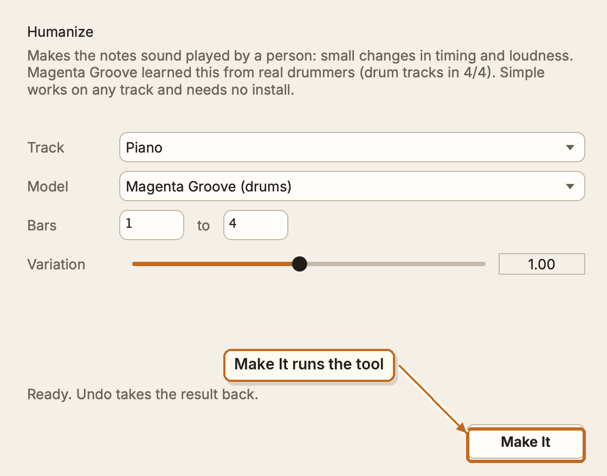

The result replaces the notes in those bars, or goes on a new track. If you do
not like the result, select `Edit > Undo` and try again. Each try is
different.

The Anticipatory Music Transformer can take a minute or more, especially on a
laptop. The status shows the percentage and the time it has run, and `Stop`
cancels it. The first run also loads the model, which takes a few seconds.

You can also ask the AI chat, for example: "Write a fretless bass under bars 9
to 16", "Humanize the drums" or "Continue the lead for 4 bars".

## Arranging help

Two tools in the `AI` menu help you make the arrangement better. They do not
use an AI model. They use music rules, so they are fast and they work on any
computer. They show suggestions, not errors: you decide.

Both tools show proposals. Each proposal tells you what the tool saw, which
tracks and bars it changes, and gives one or two options (A and B).

- Select `Play A` or `Play B` to hear that option. The bars loop.
- Select `Original` to hear the bars as they are now. You can change between
  `Original`, A and B while the song plays.
- Select `Use` to make the change. It is one undo step.
- Select `Dismiss` to hide a proposal.
- Select `Stop` to stop the comparison.

The app remembers the proposals that you use and dismiss. Next time, the kinds
that you use come first.

### Arrangement Doctor

1. Select `AI > Arrangement Doctor...`.
2. Select a goal:
   - `Make a section stand out`: type the bars of the section, for example
     the chorus. The doctor compares the section with the bars before it.
     It can make the bars before it lighter, make the accompaniment play
     harder, or double chord notes an octave down or up.
   - `Give the melody room`: finds parts that play in the range of the melody
     at the same time. It can move these notes an octave down, or keep them
     only in the rests of the melody.
   - `Make busy bars clearer`: finds bars with many more notes than usual.
     It can keep only the notes on the beats, or remove notes that other
     tracks already play.
   - `Repeat less`: finds parts that play the same bar for 8 bars or more. It
     can leave space at the end of each phrase, or change every other 4 bars.
3. If the doctor finds the wrong melody track, select it in `Melody`. The
   doctor never changes the melody.
4. Select `Check`.

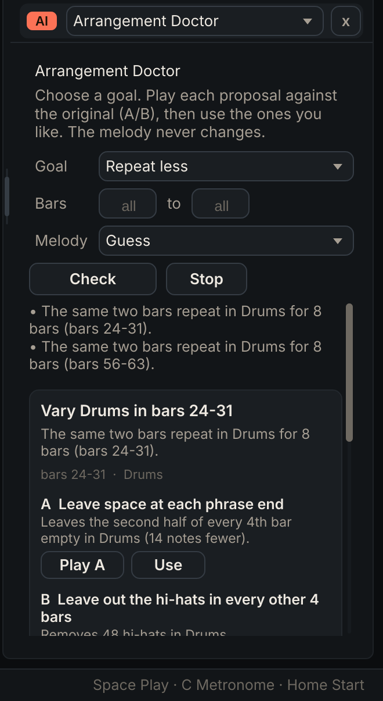

You can also ask the AI chat, for example: "Make the chorus in bars 17 to 24
stand out" or "Give the melody more room".

### Fit to My Synths

A hardware synth plays only some notes at the same time (its polyphony) and
some sounds at the same time (its parts). When a song asks for more, notes
cut off or a sound is lost. This tool checks your song against each synth
that it plays on:

- How many notes sound at the same time. A held sustain pedal counts.
- How many channels go to the synth, against its parts.
- Tracks on the same channel with different sounds.
- Notes out of the range of the synth.
- Drum parts on a synth that has no drum kit.

1. Select `AI > Fit to My Synths...`.
2. Look at the list of synths and their problems.
3. Select `Play A`, `Play B` and `Use` as above.

The bass, the melody and the drums are protected. The tool changes them only
for a range or drum-kit problem.

The tool uses the numbers in the device profile of each synth. The Roland
D-05 plays 16 notes with one tone and 8 notes with two tones, so its profile
uses 8. The XioSynth plays 8 notes. To change a number, type it under
the name of the synth and select `Save Numbers`. Your numbers are kept for
the next time. You can also ask the AI chat: "The D-05 plays 16 voices with
this patch".

## Groove

A groove is the feel of a part: how early or late each step plays, and how
loud. The Groove tool takes the groove from one part and puts it on other
parts. Use it to make stiff parts sound played, or to make all parts play
with the same feel.

1. Select `AI > Groove...`.
2. In `From`, select where the groove comes from:
   - A MIDI track. This is the most exact source.
   - An audio track. The app finds the hits in the sound. This works best
     with drums or a part with a clear rhythm.
   - `A file (MIDI or audio)...`. Select a `.mid` file or an audio file.
   - `Words (describe the feel)`. Type the feel, for example
     `lazy swing, behind the beat`, `pushed 16ths` or
     `tight kick, lazy snare, backbeat`.
3. Select `Take` (or `Choose...` for a file). The app keeps the groove in your
   groove library, and shows it in words, for example
   `Swing 62% (8ths), 14 ms behind the beat`.
4. In `Groove`, select a groove. The built-in grooves are at the top. Your
   grooves are under `Your grooves`.
5. In `Put on`, select one track, or `All other tracks`.
6. Set the amounts:
   - `Timing`: how far the notes move to the timing of the groove.
   - `Accents`: how much of the loud and soft steps of the groove the notes
     take. The part keeps its own level.
   - `Kick`, `Snare` and `Hi-hats`: for drum parts only. For example, set
     `Kick` to 0 % to keep the kick on the grid.
7. Read the `Feel match` line. It compares the parts with the groove now and
   with the groove on them (100 is the same feel).
8. Select `Play Before` and `Play After` to compare. The bars loop. The song
   does not change.
9. Select `Apply`. It is one undo step.

If the loop is on, the tool takes and changes only the bars of the loop.

The app keeps your grooves as `.groove` files in the `Grooves` folder of the
app data. You can copy them to another computer.

You can also ask the AI chat, for example: "Take the groove from the drums
and put it on the bass and the piano, but keep the kick tight", or "Give the
keys a lazy swing feel". The assistant can compare the result with the groove
and try other amounts.


## Song Forms

A song form is another order of the sections of your song. For example: a
short version, a longer intro, a version for a gig, or a break for a solo.
The app keeps each form in the song. It does not copy the Timeline. The
Timeline changes only when you use a form.

1. Select `AI > Song Forms...`.
2. Look at the sections. Each line is a name and its bars, for example
   `Chorus 1: 13-20`. If the song has no saved sections, the app finds them
   from the music. Correct the names or bars if necessary, then select
   `Save Sections`. Each section must have its own name.
3. Select a form in `New form`, then select `Make`:
   - `Short version`: the intro, the first verse and chorus, the last chorus
     and the outro.
   - `Long intro`: the intro two times. The first time, only the drums and
     the bass play.
   - `Gig version`: the intro two times, the last chorus two times and a
     final chord.
   - `Instrumental break`: a verse without the melody before the last chorus.
     Use it for a solo.
   - `My order`: type the section names in order, for example
     `Intro, Verse 1, Chorus 1 x2, Verse 2 (no melody), Outro`. `x2` plays a
     section two times. `(no melody)` rests the melody in that part. You can
     also give a track name or `bass`, `drums` or `chords`.
4. Select `Play Form` to hear the form from its start. The song does not
   change.

Where a form puts two sections together that are not together in the
original, the app adds a transition at the join:

| Transition | What it does |
| --- | --- |
| Drum fill | A fill on the drums in the last beat or two. If the song has a style, the style's Fill In plays. |
| Lead-in | The last two beats that come before the next section in the original. Without them, the bass walks up to the next section. |
| Hold the chord | The band holds the chord for the last two beats. |
| Break | One beat of silence. |
| Straight cut | No change. |

`Automatic` selects the transition that fits both sides. The card shows why.
For example, a drum fill before a busier section, or a held chord before a
quieter section. To compare, select `Play` at the join. Two bars on each side
of the join play again and again. Change the transition while it plays.

5. Select `Use` to write the form on the Timeline. It is one undo step. The
   sections then follow the form, and the forms are removed. `Undo` brings
   back the original song and its forms.

The saved sections show on the ruler of the Timeline.


You can also ask the AI chat, for example: "Make a short version of this song"
or "Use a held chord before the outro".

## Files

| Action | Menu | Key |
| --- | --- | --- |
| New project | `File > New` | `Cmd+N` |
| Open a project or a MIDI file | `File > Open...` | `Cmd+O` |
| Open a file that you used recently | `File > Open Recent` | |
| Save | `File > Save` | `Cmd+S` |
| Save with a new name | `File > Save As...` | `Cmd+Shift+S` |
| Import a MIDI file | `File > Import MIDI File...` | `Cmd+Shift+I` |
| Export a MIDI file | `File > Export MIDI File...` | `Cmd+Shift+E` |
| Import an audio file | `File > Import Audio File...` | |
| Import a score | `File > Import MusicXML File...` | |
| Export the score | `File > Export MusicXML File...` | |
| Export the mix as a WAV file | `File > Export Audio File...` | |
| Export a song for the PSR-S970 | `File > Export Song for PSR-S970...` | |

Project files have the extension `.arranger`.

`File > Open Recent` shows the last 10 files that you opened or saved. The
newest file is at the top. Files that you moved or deleted are not on the
list. To remove all the files from the list, select `Clear List`.

Each file window starts in the last folder that you used for that type of
file. For example, `Export MIDI File...` starts in the folder of your last
MIDI export, and `Open...` starts in the folder of your last project.

A project file does not contain the audio. It contains the paths of the audio files.
If you move or delete an audio file, its clips show `File not found`.

When you import a MIDI file, each MIDI channel becomes one track. The app
keeps the tempo, the meter, the sounds and the mixer values from the file.

MusicXML is the file type that notation programs share (Sibelius, Finale,
Dorico, MuseScore). The app opens `.musicxml`, `.xml` and `.mxl` files. Each
part becomes one track. The app keeps the notes, the key, the meter, the
tempo and the sounds. It also keeps chord symbols, lyrics (the first verse),
dynamics and articulations. It does not keep slurs and other marks.

When you export a MusicXML file, the file contains the score of all tracks
that have notes on the Timeline. The app writes a `.musicxml` file.

## Play your song on the PSR-S970

You can play your song on the Yamaha PSR-S970 without the computer. There
are three ways.

### Export a song file for the keyboard

1. Select `File > Export Song for PSR-S970...`.
2. Read the list. It shows the keyboard voice and the MIDI channel of each
   track, and the tracks that are not in the file.
3. Click `Save...` and select a name.
4. Copy the `.mid` file to a USB stick.
5. Put the USB stick into the keyboard. Open the file in the keyboard's
   Song player and play it.

The app selects a voice for each track:

- A track that plays on the PSR-S970 keeps its voice.
- A track on another synth or on the SoundFont gets the nearest keyboard
  voice: a voice with the same name, the same General MIDI sound, or a voice
  found from words in the sound name ("pad", "bass" and so on).
- A drum track gets a drum kit on channel 10.

To use a different voice, set the track output to the PSR-S970 and select
the voice in the app before you export.

The file also contains:

- The tempo, the time signature and the lyrics.
- Beat patterns. Each pattern repeats for the full length of its clip.
- The volume, pan, reverb and chorus lines of the tracks.
- The chord symbols of the Score. The keyboard shows the chord while the
  song plays.

**Note:** The music starts at bar 2. In bar 1 the keyboard gets its voices.

**Note:** Audio tracks and muted tracks are not in the file. Export the
audio as a WAV file (see below).

### Export the mix as a WAV file

The PSR-S970 also plays WAV files from a USB stick.

1. Select `File > Export Audio File...`.
2. Select a name. The app plays the song quickly and saves the sound as a
   24-bit WAV file.

Tracks on hardware synths play on the SoundFont with the nearest General
MIDI sound, because the app cannot record the synths in this step. To keep
the real sound of a synth, record it on an audio track first.

### Record on the keyboard

The keyboard can record what the app plays.

1. Connect the keyboard to the computer with a USB cable.
2. Set the outputs of the tracks to the PSR-S970.
3. On the keyboard, start the Song recorder.
4. In the app, play the song.
5. On the keyboard, stop the recorder and save the song.

**Note:** This was not tried on the keyboard yet. If the recorder does not
record the notes from the app, export a song file instead.

## Undo

Push `Cmd+Z` to undo the last change. Push `Cmd+Shift+Z` to redo it. The
`Edit` menu shows the name of the change.

## Keyboard shortcuts

You can change the keys of the menu commands.

1. Select `Options > Keyboard Shortcuts...`.
2. Find the command. The commands are in groups with the names of the menus.
3. Click `+` at the right of the command.
4. Push the new key or key combination.
5. Click `OK`.

If a different command uses the key, the app tells you. You can then give the key to the new command or cancel.

| To do this | Do this |
| --- | --- |
| Change a shortcut | Click the shortcut and select `Change this key-mapping` |
| Remove a shortcut | Click the shortcut and select `Remove this key-mapping` |
| Get the standard keys back | Click `Reset to Standard Keys` |

A command can have more than one shortcut. The app keeps your shortcuts when you close it.

Hold the mouse over a button to see its shortcut after the description, in
brackets. The tip follows a shortcut you change.

The window shows the menu commands only. Keys that work in one view only, for example the note keys of the Score view, do not change.

## Look

Select `View > Dark Theme` or `View > Light Theme`.

## About and updates

Select `Options > About Lazy Arranger Midi DAW` to see the app version.

The app checks the public release page when it starts. If a newer version is available, the app shows a message with three buttons:

- `Download` opens the public release page in your browser.
- `Later` closes the message. The app shows the message again at the next start.
- `Skip This Version` hides this version. The app shows the message again only when a newer version is available.

Select `Options > Check for Updates...` to check now. The app tells you when it has the latest version, or when it cannot reach the release page.

The check only reads the public release page. It sends no song data.

## If something goes wrong

| Problem | What to do |
| --- | --- |
| No sound from a SoundFont track | Make sure that an audio device is open and a SoundFont is loaded. The inspector shows the two. |
| No sound from a synth | Make sure that the track output is the MIDI port of the synth and the channel is correct. |
| The keyboard does not record | Look for the dot in the bottom bar. If it does not come on, turn on the keyboard input in `Audio and MIDI Settings...`. You turned it off before, or it is a software port. |
| A synth plays the wrong sound | Select the sound again. If the list is incorrect, check the device profile. |
| The sound editor does not change the synth | Make sure that the channel in the sound editor is the MIDI channel of the synth. On the D-05, the device ID must agree with the channel. |
| `Get Sound Names` finds no names | Turn on the MIDI input of the synth in `Options > Audio and MIDI Settings...`. |
| A controller does nothing | Make sure that all MIDI inputs of the controller are on in `Audio and MIDI Settings...`. For the X-Touch Mini, make sure that the `MC MODE` light is off. |
